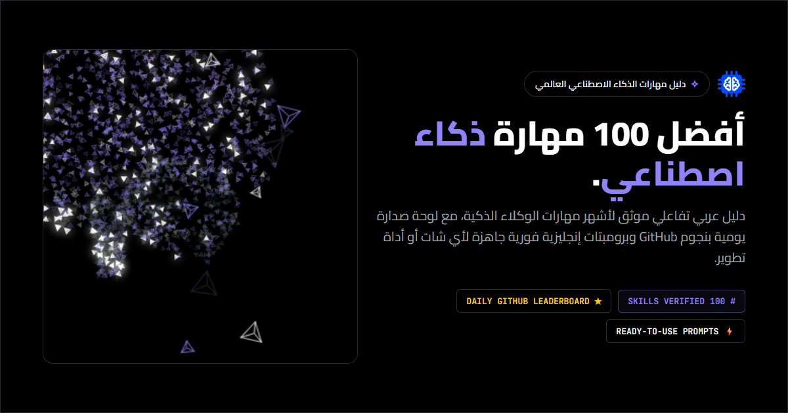

# 🏆 Top 100 AI Agent Skills

> **Curated open-source directory, daily GitHub star leaderboard, and local-first MCP server for verified `SKILL.md` agent skills — built in English and Arabic.**

<div align="center">

<p align="center">
  <a href="https://top-100-agent-skills.vercel.app/">
    
  </a>
</p>

[](https://top-100-agent-skills.vercel.app/)
[](https://www.npmjs.com/package/top-100-agent-skills)
[](.github/workflows/daily-rank-sync.yml)
[](data/leaderboard.json)
[](LICENSE)

[](https://hub.xerj.org/contributors/SayedGameaSayed)

</div>

---

## ✨ Key Highlights

1. **100 Human-Vetted Agent Skills:** Every active entry links to a verified upstream `SKILL.md` instruction file checked for license compliance and URL availability. Unvetted repositories discovered by automation remain quarantined in [`data/candidates.json`](data/candidates.json).
2. **Autonomous Daily Leaderboard:** [GitHub Actions](.github/workflows/daily-rank-sync.yml) refreshes upstream repository star counts every 24 hours and publishes updated rankings to [`data/leaderboard.json`](data/leaderboard.json).
3. **Built-in MCP Server (`npx` Ready):** Connect any MCP-compatible IDE or agent directly to the catalog over stdio with zero API keys via `npx -y top-100-agent-skills`.
4. **Zero-Key AI Skills Advisor + Local Fallback:** Deployed on Vercel with specialist task routing (`/api/advisor`) and an instant client-side semantic fallback when offline or running on static mirrors.
5. **Bilingual by Design (English Default + Arabic RTL):** Full native English interface at [`top-100-agent-skills.vercel.app`](https://top-100-agent-skills.vercel.app/) with instant switch to Arabic RTL at [`?lang=ar`](https://top-100-agent-skills.vercel.app/?lang=ar).

---

## 🔌 MCP Server Quickstart (`npx top-100-agent-skills`)

Connect your coding agent (**Claude Code**, **Cursor**, **Claude Desktop**, **Windsurf**, or **Google Antigravity**) directly to the curated catalog over local `stdio` — zero API keys or network calls required:

```json
{
  "mcpServers": {
    "top-100-agent-skills": {
      "command": "npx",
      "args": ["-y", "top-100-agent-skills"]
    }
  }
}
```

### Available MCP Tools

| Tool | Description | External Calls |
|---|---|---|
| `search_skills` | Fuzzy & normalized English/Arabic search filtered by category or difficulty | None (local) |
| `get_skill` | Full metadata, license status, verified upstream URL, and ready-to-use prompt | None (local) |
| `get_leaderboard` | Ranked skills ordered by upstream GitHub repository stars | None (local) |
| `recommend_skills_for_task` | Local task & stack classifier returning best matching skills for code or AI projects | None (local) |

> 📦 **Data Snapshot Note:** The published npm package bundles a zero-latency local snapshot (`data/skills.json` and `data/leaderboard.json`) refreshed on each `npm publish`. Meanwhile, the live website and GitHub repository sync upstream stars daily via GitHub Actions.

---

## 🚀 Using Skills Across Tools & IDEs

| Tool / Environment | Quick Activation |
|---|---|
| **Claude Code** | Copy a skill URL and instruct Claude: `Read this skill: <url>`, or attach the MCP server above. |
| **Cursor IDE** | Add instructions to `.cursorrules` or `.cursor/rules/`, or connect via MCP. |
| **Google Antigravity** | Place `SKILL.md` under `~/.gemini/antigravity/builtin/skills/<name>/SKILL.md` or connect via MCP. |
| **GitHub Copilot** | Reference instructions inside `.github/copilot-instructions.md`. |
| **Roo Code / Cline** | Add the skill folder to `.roo/skills/` or configure it as custom instructions. |
| **ChatGPT / Gemini / Claude Web** | Click **Copy Prompt** on any skill card and paste directly into chat. |

---

## 🏛️ Hybrid Architecture, Security & Privacy

This repository cleanly separates **client-side catalog discovery** from the **optional AI Skills Advisor**:

- **Catalog Search & Leaderboard (100% Client-Side):** Filtering, Arabic/English search normalization ([`site/js/search.js`](site/js/search.js)), theme switching, and prompt copying run locally in your browser with zero external requests. GitHub Pages hosts this static mirror cleanly with an offline semantic fallback.
- **Optional AI Skills Advisor ([`api/advisor.js`](api/advisor.js)):** On the Vercel production deployment, submitted prompts and optional code snippets attached via the browser dropzone are sent over HTTPS to external inference providers (**Groq**, **Google Gemini**, and **OpenRouter**) to generate specialist skill recommendations.
- **Privacy & Abuse Hardening:**
  - Prompts sent to `/api/advisor` are strictly capped at **1,000 characters** (`HTTP 400` if exceeded).
  - Browser code attachments are stored in **`localStorage` only** (max 3 files, 50 KB/file, 6,000 chars total), never saved to any backend database, and common secret/lockfile patterns (`.env*`, `.pem`, `.key`, `package-lock.json`) are blocked client-side.
  - Cross-origin requests to `/api/advisor` are restricted via an explicit allowlist, upstream keys reside strictly in server environment variables, and internal errors are never leaked to clients.
  - Read the full threat model and serverless rate-limiter notes in [`SECURITY.md`](SECURITY.md).

---

## 📡 Public JSON Endpoints

Consume the verified leaderboard and catalog directly inside scripts, CI pipelines, or agent tools:

```bash
# Fetch live Top 100 skills ranked by GitHub stars
curl -s https://raw.githubusercontent.com/SayedGameaSayed/top-100-agent-skills/main/data/leaderboard.json

# Fetch full curated skills catalog (bilingual metadata & prompts)
curl -s https://raw.githubusercontent.com/SayedGameaSayed/top-100-agent-skills/main/data/skills.json
```

---

## 🏆 Top 100 AI Agent Skills Leaderboard

<!-- LEADERBOARD_START -->
> 🔄 **Last Automated Sync:** 2026-11-24 | **Metric:** Upstream Repository GitHub Stars | [Download JSON](data/leaderboard.json)
> ⚠️ **Note:** Star counts reflect the upstream GitHub repository as a whole rather than individual skill files.

| Rank | Repo Stars ★ | Skill | Category | Upstream Repository | Guide & Prompt | Status |
|:---:|:---:|---|---|---|:---:|:---:|
| **🥇 1** | `332k` | [**diagnosing-bugs**](https://github.com/mattpocock/skills/tree/main/skills/engineering/diagnosing-bugs) | Code Quality & Testing | [`mattpocock/skills`](https://github.com/mattpocock/skills) | [**Diagnosing Engineering Bugs** ↗](https://top-100-agent-skills.vercel.app/skill.html?id=mp-diagnosing-bugs) | ✅ Verified |
| **🥈 2** | `332k` | [**grill-with-docs**](https://github.com/mattpocock/skills/tree/main/skills/engineering/grill-with-docs) | Development & Web | [`mattpocock/skills`](https://github.com/mattpocock/skills) | [**Documentation Stress-Testing** ↗](https://top-100-agent-skills.vercel.app/skill.html?id=grill-with-docs) | ✅ Verified |
| **🥉 3** | `332k` | [**triage**](https://github.com/mattpocock/skills/tree/main/skills/engineering/triage) | Code Quality & Testing | [`mattpocock/skills`](https://github.com/mattpocock/skills) | [**Issue Triage & Prioritization** ↗](https://top-100-agent-skills.vercel.app/skill.html?id=triage) | ✅ Verified |
| **#4** | `332k` | [**improve-codebase-architecture**](https://github.com/mattpocock/skills/tree/main/skills/engineering/improve-codebase-architecture) | Development & Web | [`mattpocock/skills`](https://github.com/mattpocock/skills) | [**Codebase Architecture Refactoring** ↗](https://top-100-agent-skills.vercel.app/skill.html?id=improve-codebase-architecture) | ✅ Verified |
| **#5** | `332k` | [**tdd**](https://github.com/mattpocock/skills/tree/main/skills/engineering/tdd) | Code Quality & Testing | [`mattpocock/skills`](https://github.com/mattpocock/skills) | [**Matt Pocock TDD Methodology** ↗](https://top-100-agent-skills.vercel.app/skill.html?id=mp-tdd) | ✅ Verified |
| **#6** | `332k` | [**to-tickets**](https://github.com/mattpocock/skills/tree/main/skills/engineering/to-tickets) | Development & Web | [`mattpocock/skills`](https://github.com/mattpocock/skills) | [**Spec-to-Tickets Breakdown** ↗](https://top-100-agent-skills.vercel.app/skill.html?id=to-tickets) | ✅ Verified |
| **#7** | `332k` | [**to-spec**](https://github.com/mattpocock/skills/tree/main/skills/engineering/to-spec) | Development & Web | [`mattpocock/skills`](https://github.com/mattpocock/skills) | [**PRD to Technical Specification** ↗](https://top-100-agent-skills.vercel.app/skill.html?id=to-spec) | ✅ Verified |
| **#8** | `332k` | [**grill-me**](https://github.com/mattpocock/skills/tree/main/skills/productivity/grill-me) | Development & Web | [`mattpocock/skills`](https://github.com/mattpocock/skills) | [**Interactive Architecture Griller** ↗](https://top-100-agent-skills.vercel.app/skill.html?id=grill-me) | ✅ Verified |
| **#9** | `332k` | [**setup-pre-commit**](https://github.com/mattpocock/skills/tree/main/skills/misc/setup-pre-commit) | Code Quality & Testing | [`mattpocock/skills`](https://github.com/mattpocock/skills) | [**Pre-Commit Hooks & Lint Guardrails** ↗](https://top-100-agent-skills.vercel.app/skill.html?id=setup-pre-commit) | ✅ Verified |
| **#10** | `332k` | [**git-guardrails-claude-code**](https://github.com/mattpocock/skills/tree/main/skills/misc/git-guardrails-claude-code) | Development & Web | [`mattpocock/skills`](https://github.com/mattpocock/skills) | [**Git Guardrails for Claude Code** ↗](https://top-100-agent-skills.vercel.app/skill.html?id=git-guardrails-claude-code) | ✅ Verified |
| **#11** | `332k` | [**writing-for-agents**](https://github.com/mattpocock/skills/tree/main/skills/productivity/writing-for-agents) | Writing & Communication | [`mattpocock/skills`](https://github.com/mattpocock/skills) | [**Writing Instructions for AI Agents** ↗](https://top-100-agent-skills.vercel.app/skill.html?id=writing-for-agents) | ✅ Verified |
| **#12** | `332k` | [**codebase-design**](https://github.com/mattpocock/skills/tree/main/skills/engineering/codebase-design) | Development & Web | [`mattpocock/skills`](https://github.com/mattpocock/skills) | [**Modular Codebase Design Principles** ↗](https://top-100-agent-skills.vercel.app/skill.html?id=codebase-design) | ✅ Verified |
| **#13** | `332k` | [**code-review**](https://github.com/mattpocock/skills/tree/main/skills/engineering/code-review) | Code Quality & Testing | [`mattpocock/skills`](https://github.com/mattpocock/skills) | [**TypeScript Code Review Master** ↗](https://top-100-agent-skills.vercel.app/skill.html?id=mp-code-review) | ✅ Verified |
| **#14** | `325.7k` | [**writing-plans**](https://github.com/obra/superpowers/tree/main/skills/writing-plans) | Development & Web | [`obra/superpowers`](https://github.com/obra/superpowers) | [**Step-by-Step Software Planning** ↗](https://top-100-agent-skills.vercel.app/skill.html?id=obra-writing-plans) | ✅ Verified |
| **#15** | `325.7k` | [**systematic-debugging**](https://github.com/obra/superpowers/tree/main/skills/systematic-debugging) | Code Quality & Testing | [`obra/superpowers`](https://github.com/obra/superpowers) | [**Systematic Debugging** ↗](https://top-100-agent-skills.vercel.app/skill.html?id=systematic-debugging) | ✅ Verified |
| **#16** | `325.7k` | [**test-driven-development**](https://github.com/obra/superpowers/tree/main/skills/test-driven-development) | Code Quality & Testing | [`obra/superpowers`](https://github.com/obra/superpowers) | [**Test-Driven Development (TDD)** ↗](https://top-100-agent-skills.vercel.app/skill.html?id=test-driven-development) | ✅ Verified |
| **#17** | `325.7k` | [**requesting-code-review**](https://github.com/obra/superpowers/tree/main/skills/requesting-code-review) | Code Quality & Testing | [`obra/superpowers`](https://github.com/obra/superpowers) | [**Requesting Code Review** ↗](https://top-100-agent-skills.vercel.app/skill.html?id=requesting-code-review) | ✅ Verified |
| **#18** | `325.7k` | [**receiving-code-review**](https://github.com/obra/superpowers/tree/main/skills/receiving-code-review) | Code Quality & Testing | [`obra/superpowers`](https://github.com/obra/superpowers) | [**Receiving & Applying Code Review** ↗](https://top-100-agent-skills.vercel.app/skill.html?id=receiving-code-review) | ✅ Verified |
| **#19** | `325.7k` | [**using-git-worktrees**](https://github.com/obra/superpowers/tree/main/skills/using-git-worktrees) | Code Quality & Testing | [`obra/superpowers`](https://github.com/obra/superpowers) | [**Git Worktrees Multi-Tasking** ↗](https://top-100-agent-skills.vercel.app/skill.html?id=using-git-worktrees) | ✅ Verified |
| **#20** | `325.7k` | [**verification-before-completion**](https://github.com/obra/superpowers/tree/main/skills/verification-before-completion) | Code Quality & Testing | [`obra/superpowers`](https://github.com/obra/superpowers) | [**Verification Before Completion** ↗](https://top-100-agent-skills.vercel.app/skill.html?id=verification-before-completion) | ✅ Verified |
| **#21** | `325.7k` | [**subagent-driven-development**](https://github.com/obra/superpowers/tree/main/skills/subagent-driven-development) | Skill Creation & Meta | [`obra/superpowers`](https://github.com/obra/superpowers) | [**Subagent-Driven Development** ↗](https://top-100-agent-skills.vercel.app/skill.html?id=subagent-driven-development) | ✅ Verified |
| **#22** | `325.7k` | [**executing-plans**](https://github.com/obra/superpowers/tree/main/skills/executing-plans) | Skill Creation & Meta | [`obra/superpowers`](https://github.com/obra/superpowers) | [**Autonomous Plan Execution** ↗](https://top-100-agent-skills.vercel.app/skill.html?id=executing-plans) | ✅ Verified |
| **#23** | `325.7k` | [**dispatching-parallel-agents**](https://github.com/obra/superpowers/tree/main/skills/dispatching-parallel-agents) | Skill Creation & Meta | [`obra/superpowers`](https://github.com/obra/superpowers) | [**Dispatching Parallel Agents** ↗](https://top-100-agent-skills.vercel.app/skill.html?id=dispatching-parallel-agents) | ✅ Verified |
| **#24** | `325.7k` | [**brainstorming-solutions**](https://github.com/obra/superpowers/tree/main/skills/brainstorming) | Skill Creation & Meta | [`obra/superpowers`](https://github.com/obra/superpowers) | [**Architectural Solution Brainstorming** ↗](https://top-100-agent-skills.vercel.app/skill.html?id=brainstorming-solutions) | ✅ Verified |
| **#25** | `325.7k` | [**finishing-a-development-branch**](https://github.com/obra/superpowers/tree/main/skills/finishing-a-development-branch) | Code Quality & Testing | [`obra/superpowers`](https://github.com/obra/superpowers) | [**Finishing Development Branches** ↗](https://top-100-agent-skills.vercel.app/skill.html?id=finishing-development-branch) | ✅ Verified |
| **#26** | `325.7k` | [**using-superpowers**](https://github.com/obra/superpowers/tree/main/skills/using-superpowers) | Skill Creation & Meta | [`obra/superpowers`](https://github.com/obra/superpowers) | [**Superpowers Agent Framework** ↗](https://top-100-agent-skills.vercel.app/skill.html?id=using-superpowers) | ✅ Verified |
| **#27** | `325.7k` | [**diagnosing-superpowers**](https://github.com/obra/superpowers/tree/main/skills/diagnosing-superpowers) | Code Quality & Testing | [`obra/superpowers`](https://github.com/obra/superpowers) | [**Superpowers Skill Diagnostics** ↗](https://top-100-agent-skills.vercel.app/skill.html?id=diagnosing-superpowers) | ✅ Verified |
| **#28** | `325.7k` | [**writing-skills**](https://github.com/obra/superpowers/tree/main/skills/writing-skills) | Skill Creation & Meta | [`obra/superpowers`](https://github.com/obra/superpowers) | [**Agent Skill Authoring & Formatting** ↗](https://top-100-agent-skills.vercel.app/skill.html?id=writing-skills) | ✅ Verified |
| **#29** | `310k` | [**fastapi-patterns**](https://github.com/affaan-m/ECC/tree/main/skills/fastapi-patterns) | Development & Web | [`affaan-m/ECC`](https://github.com/affaan-m/ECC) | [**FastAPI Production Patterns** ↗](https://top-100-agent-skills.vercel.app/skill.html?id=fastapi-patterns) | ✅ Verified |
| **#30** | `310k` | [**prisma-patterns**](https://github.com/affaan-m/ECC/tree/main/skills/prisma-patterns) | Development & Web | [`affaan-m/ECC`](https://github.com/affaan-m/ECC) | [**Prisma ORM Database Patterns** ↗](https://top-100-agent-skills.vercel.app/skill.html?id=prisma-patterns) | ✅ Verified |
| **#31** | `310k` | [**swiftui-patterns**](https://github.com/affaan-m/ECC/tree/main/skills/swiftui-patterns) | Development & Web | [`affaan-m/ECC`](https://github.com/affaan-m/ECC) | [**SwiftUI Native iOS Patterns** ↗](https://top-100-agent-skills.vercel.app/skill.html?id=swiftui-patterns) | ✅ Verified |
| **#32** | `310k` | [**rust-patterns**](https://github.com/affaan-m/ECC/tree/main/skills/rust-patterns) | Development & Web | [`affaan-m/ECC`](https://github.com/affaan-m/ECC) | [**Rust Idiomatic Systems Patterns** ↗](https://top-100-agent-skills.vercel.app/skill.html?id=rust-patterns) | ✅ Verified |
| **#33** | `310k` | [**redis-patterns**](https://github.com/affaan-m/ECC/tree/main/skills/redis-patterns) | Development & Web | [`affaan-m/ECC`](https://github.com/affaan-m/ECC) | [**Redis Caching & Pub/Sub Patterns** ↗](https://top-100-agent-skills.vercel.app/skill.html?id=redis-patterns) | ✅ Verified |
| **#34** | `310k` | [**react-testing-library**](https://github.com/affaan-m/ECC/tree/main/skills/react-testing) | Code Quality & Testing | [`affaan-m/ECC`](https://github.com/affaan-m/ECC) | [**React Testing Library Suite** ↗](https://top-100-agent-skills.vercel.app/skill.html?id=react-testing-library) | ✅ Verified |
| **#35** | `310k` | [**python-pytest-suite**](https://github.com/affaan-m/ECC/tree/main/skills/python-testing) | Code Quality & Testing | [`affaan-m/ECC`](https://github.com/affaan-m/ECC) | [**Python Pytest Automation Suite** ↗](https://top-100-agent-skills.vercel.app/skill.html?id=python-pytest-suite) | ✅ Verified |
| **#36** | `310k` | [**django-security**](https://github.com/affaan-m/ECC/tree/main/skills/django-security) | Cloud & Security | [`affaan-m/ECC`](https://github.com/affaan-m/ECC) | [**Django Security Hardening** ↗](https://top-100-agent-skills.vercel.app/skill.html?id=django-security) | ✅ Verified |
| **#37** | `310k` | [**springboot-security**](https://github.com/affaan-m/ECC/tree/main/skills/springboot-security) | Cloud & Security | [`affaan-m/ECC`](https://github.com/affaan-m/ECC) | [**Spring Boot Security Architecture** ↗](https://top-100-agent-skills.vercel.app/skill.html?id=springboot-security) | ✅ Verified |
| **#38** | `310k` | [**security-review-checklist**](https://github.com/affaan-m/ECC/tree/main/skills/security-review) | Cloud & Security | [`affaan-m/ECC`](https://github.com/affaan-m/ECC) | [**Comprehensive Security Review** ↗](https://top-100-agent-skills.vercel.app/skill.html?id=security-review-checklist) | ✅ Verified |
| **#39** | `310k` | [**pytorch-model-eval**](https://github.com/affaan-m/ECC/tree/main/skills/pytorch-patterns) | Data & AI | [`affaan-m/ECC`](https://github.com/affaan-m/ECC) | [**PyTorch Model Evaluation & Metrics** ↗](https://top-100-agent-skills.vercel.app/skill.html?id=pytorch-model-eval) | ✅ Verified |
| **#40** | `310k` | [**marketing-campaign**](https://github.com/affaan-m/ECC/tree/main/skills/marketing-campaign) | Business & Finance | [`affaan-m/ECC`](https://github.com/affaan-m/ECC) | [**Marketing Campaign Strategy** ↗](https://top-100-agent-skills.vercel.app/skill.html?id=marketing-campaign) | ✅ Verified |
| **#41** | `310k` | [**i18n-sync-manager**](https://github.com/affaan-m/ECC/tree/main/skills/i18n-sync) | Writing & Communication | [`affaan-m/ECC`](https://github.com/affaan-m/ECC) | [**i18n Localization Sync Manager** ↗](https://top-100-agent-skills.vercel.app/skill.html?id=i18n-sync-manager) | ✅ Verified |
| **#42** | `310k` | [**golang-testing-suite**](https://github.com/affaan-m/ECC/tree/main/skills/golang-testing) | Code Quality & Testing | [`affaan-m/ECC`](https://github.com/affaan-m/ECC) | [**Go Testing & Benchmarking Suite** ↗](https://top-100-agent-skills.vercel.app/skill.html?id=golang-testing-suite) | ✅ Verified |
| **#43** | `310k` | [**eval-harness**](https://github.com/affaan-m/ECC/tree/main/skills/eval-harness) | Code Quality & Testing | [`affaan-m/ECC`](https://github.com/affaan-m/ECC) | [**AI Evaluation & Benchmarking Harness** ↗](https://top-100-agent-skills.vercel.app/skill.html?id=eval-harness) | ✅ Verified |
| **#44** | `199.8k` | [**pdf**](https://github.com/anthropics/skills/tree/main/skills/pdf) | Documents & Files | [`anthropics/skills`](https://github.com/anthropics/skills) | [**PDF Document Master** ↗](https://top-100-agent-skills.vercel.app/skill.html?id=pdf) | ✅ Verified |
| **#45** | `199.8k` | [**docx**](https://github.com/anthropics/skills/tree/main/skills/docx) | Documents & Files | [`anthropics/skills`](https://github.com/anthropics/skills) | [**Word Document (DOCX) Handler** ↗](https://top-100-agent-skills.vercel.app/skill.html?id=docx) | ✅ Verified |
| **#46** | `199.8k` | [**xlsx**](https://github.com/anthropics/skills/tree/main/skills/xlsx) | Documents & Files | [`anthropics/skills`](https://github.com/anthropics/skills) | [**Excel Spreadsheet (XLSX) Pro** ↗](https://top-100-agent-skills.vercel.app/skill.html?id=xlsx) | ✅ Verified |
| **#47** | `199.8k` | [**pptx**](https://github.com/anthropics/skills/tree/main/skills/pptx) | Documents & Files | [`anthropics/skills`](https://github.com/anthropics/skills) | [**PowerPoint Presentation (PPTX)** ↗](https://top-100-agent-skills.vercel.app/skill.html?id=pptx) | ✅ Verified |
| **#48** | `199.8k` | [**frontend-design**](https://github.com/anthropics/skills/tree/main/skills/frontend-design) | Design & Creative | [`anthropics/skills`](https://github.com/anthropics/skills) | [**Frontend UI/UX Design System** ↗](https://top-100-agent-skills.vercel.app/skill.html?id=frontend-design) | ✅ Verified |
| **#49** | `199.8k` | [**skill-creator**](https://github.com/anthropics/skills/tree/main/skills/skill-creator) | Skill Creation & Meta | [`anthropics/skills`](https://github.com/anthropics/skills) | [**AI Skill Creator & Architect** ↗](https://top-100-agent-skills.vercel.app/skill.html?id=skill-creator) | ✅ Verified |
| **#50** | `199.8k` | [**webapp-testing**](https://github.com/anthropics/skills/tree/main/skills/webapp-testing) | Code Quality & Testing | [`anthropics/skills`](https://github.com/anthropics/skills) | [**End-to-End Web App Testing** ↗](https://top-100-agent-skills.vercel.app/skill.html?id=webapp-testing) | ✅ Verified |
| **#51** | `199.8k` | [**mcp-builder**](https://github.com/anthropics/skills/tree/main/skills/mcp-builder) | Development & Web | [`anthropics/skills`](https://github.com/anthropics/skills) | [**Model Context Protocol (MCP) Builder** ↗](https://top-100-agent-skills.vercel.app/skill.html?id=mcp-builder) | ✅ Verified |
| **#52** | `199.8k` | [**canvas-design**](https://github.com/anthropics/skills/tree/main/skills/canvas-design) | Design & Creative | [`anthropics/skills`](https://github.com/anthropics/skills) | [**HTML5 Canvas Visuals & Generative Art** ↗](https://top-100-agent-skills.vercel.app/skill.html?id=canvas-design) | ✅ Verified |
| **#53** | `199.8k` | [**web-artifacts-builder**](https://github.com/anthropics/skills/tree/main/skills/web-artifacts-builder) | Development & Web | [`anthropics/skills`](https://github.com/anthropics/skills) | [**Standalone Web Artifacts Builder** ↗](https://top-100-agent-skills.vercel.app/skill.html?id=web-artifacts-builder) | ✅ Verified |
| **#54** | `199.8k` | [**brand-guidelines**](https://github.com/anthropics/skills/tree/main/skills/brand-guidelines) | Design & Creative | [`anthropics/skills`](https://github.com/anthropics/skills) | [**Brand Guidelines & Identity System** ↗](https://top-100-agent-skills.vercel.app/skill.html?id=brand-guidelines) | ✅ Verified |
| **#55** | `199.8k` | [**theme-factory**](https://github.com/anthropics/skills/tree/main/skills/theme-factory) | Design & Creative | [`anthropics/skills`](https://github.com/anthropics/skills) | [**Design System Theme Factory** ↗](https://top-100-agent-skills.vercel.app/skill.html?id=theme-factory) | ✅ Verified |
| **#56** | `199.8k` | [**doc-coauthoring**](https://github.com/anthropics/skills/tree/main/skills/doc-coauthoring) | Writing & Communication | [`anthropics/skills`](https://github.com/anthropics/skills) | [**Collaborative Document Co-Authoring** ↗](https://top-100-agent-skills.vercel.app/skill.html?id=doc-coauthoring) | ✅ Verified |
| **#57** | `199.8k` | [**algorithmic-art**](https://github.com/anthropics/skills/tree/main/skills/algorithmic-art) | Design & Creative | [`anthropics/skills`](https://github.com/anthropics/skills) | [**Algorithmic Art & Generative Patterns** ↗](https://top-100-agent-skills.vercel.app/skill.html?id=algorithmic-art) | ✅ Verified |
| **#58** | `199.8k` | [**internal-comms**](https://github.com/anthropics/skills/tree/main/skills/internal-comms) | Writing & Communication | [`anthropics/skills`](https://github.com/anthropics/skills) | [**Internal Communications & Updates** ↗](https://top-100-agent-skills.vercel.app/skill.html?id=internal-comms) | ✅ Verified |
| **#59** | `199.8k` | [**slack-gif-creator**](https://github.com/anthropics/skills/tree/main/skills/slack-gif-creator) | Design & Creative | [`anthropics/skills`](https://github.com/anthropics/skills) | [**Custom Slack GIF & Meme Creator** ↗](https://top-100-agent-skills.vercel.app/skill.html?id=slack-gif-creator) | ✅ Verified |
| **#60** | `199.8k` | [**claude-api**](https://github.com/anthropics/skills/tree/main/skills/claude-api) | Development & Web | [`anthropics/skills`](https://github.com/anthropics/skills) | [**Claude API Integration Patterns** ↗](https://top-100-agent-skills.vercel.app/skill.html?id=claude-api) | ✅ Verified |
| **#61** | `120.2k` | [**interview-me**](https://github.com/addyosmani/agent-skills/tree/main/skills/interview-me) | Writing & Communication | [`addyosmani/agent-skills`](https://github.com/addyosmani/agent-skills) | [**Requirements Discovery Interviewer** ↗](https://top-100-agent-skills.vercel.app/skill.html?id=interview-me) | ✅ Verified |
| **#62** | `120.2k` | [**idea-refine**](https://github.com/addyosmani/agent-skills/tree/main/skills/idea-refine) | Writing & Communication | [`addyosmani/agent-skills`](https://github.com/addyosmani/agent-skills) | [**Product Idea Refinement** ↗](https://top-100-agent-skills.vercel.app/skill.html?id=idea-refine) | ✅ Verified |
| **#63** | `120.2k` | [**spec-driven-development**](https://github.com/addyosmani/agent-skills/tree/main/skills/spec-driven-development) | Code Quality & Testing | [`addyosmani/agent-skills`](https://github.com/addyosmani/agent-skills) | [**Spec-Driven Development** ↗](https://top-100-agent-skills.vercel.app/skill.html?id=spec-driven-development) | ✅ Verified |
| **#64** | `120.2k` | [**planning-and-task-breakdown**](https://github.com/addyosmani/agent-skills/tree/main/skills/planning-and-task-breakdown) | Code Quality & Testing | [`addyosmani/agent-skills`](https://github.com/addyosmani/agent-skills) | [**Engineering Task Breakdown** ↗](https://top-100-agent-skills.vercel.app/skill.html?id=planning-and-task-breakdown) | ✅ Verified |
| **#65** | `120.2k` | [**incremental-implementation**](https://github.com/addyosmani/agent-skills/tree/main/skills/incremental-implementation) | Development & Web | [`addyosmani/agent-skills`](https://github.com/addyosmani/agent-skills) | [**Incremental Code Implementation** ↗](https://top-100-agent-skills.vercel.app/skill.html?id=incremental-implementation) | ✅ Verified |
| **#66** | `120.2k` | [**frontend-ui-engineering**](https://github.com/addyosmani/agent-skills/tree/main/skills/frontend-ui-engineering) | Design & Creative | [`addyosmani/agent-skills`](https://github.com/addyosmani/agent-skills) | [**Frontend UI Engineering Pro** ↗](https://top-100-agent-skills.vercel.app/skill.html?id=frontend-ui-engineering) | ✅ Verified |
| **#67** | `120.2k` | [**api-and-interface-design**](https://github.com/addyosmani/agent-skills/tree/main/skills/api-and-interface-design) | Development & Web | [`addyosmani/agent-skills`](https://github.com/addyosmani/agent-skills) | [**API & Interface Design** ↗](https://top-100-agent-skills.vercel.app/skill.html?id=api-and-interface-design) | ✅ Verified |
| **#68** | `120.2k` | [**context-engineering**](https://github.com/addyosmani/agent-skills/tree/main/skills/context-engineering) | Skill Creation & Meta | [`addyosmani/agent-skills`](https://github.com/addyosmani/agent-skills) | [**Agent Context Window Engineering** ↗](https://top-100-agent-skills.vercel.app/skill.html?id=context-engineering) | ✅ Verified |
| **#69** | `120.2k` | [**browser-testing-with-devtools**](https://github.com/addyosmani/agent-skills/tree/main/skills/browser-testing-with-devtools) | Code Quality & Testing | [`addyosmani/agent-skills`](https://github.com/addyosmani/agent-skills) | [**Browser Testing with Chrome DevTools** ↗](https://top-100-agent-skills.vercel.app/skill.html?id=browser-testing-devtools) | ✅ Verified |
| **#70** | `120.2k` | [**debugging-and-error-recovery**](https://github.com/addyosmani/agent-skills/tree/main/skills/debugging-and-error-recovery) | Code Quality & Testing | [`addyosmani/agent-skills`](https://github.com/addyosmani/agent-skills) | [**Debugging & Error Recovery Protocols** ↗](https://top-100-agent-skills.vercel.app/skill.html?id=debugging-error-recovery) | ✅ Verified |
| **#71** | `120.2k` | [**doubt-driven-development**](https://github.com/addyosmani/agent-skills/tree/main/skills/doubt-driven-development) | Code Quality & Testing | [`addyosmani/agent-skills`](https://github.com/addyosmani/agent-skills) | [**Doubt-Driven Code Verification** ↗](https://top-100-agent-skills.vercel.app/skill.html?id=doubt-driven-development) | ✅ Verified |
| **#72** | `120.2k` | [**source-driven-development**](https://github.com/addyosmani/agent-skills/tree/main/skills/source-driven-development) | Development & Web | [`addyosmani/agent-skills`](https://github.com/addyosmani/agent-skills) | [**Source-Driven Architecture** ↗](https://top-100-agent-skills.vercel.app/skill.html?id=source-driven-development) | ✅ Verified |
| **#73** | `120.2k` | [**constraint-driven-development**](https://github.com/addyosmani/agent-skills/tree/main/skills/constraint-driven-development) | Code Quality & Testing | [`addyosmani/agent-skills`](https://github.com/addyosmani/agent-skills) | [**Constraint-Driven Development** ↗](https://top-100-agent-skills.vercel.app/skill.html?id=constraint-driven-development) | ✅ Verified |
| **#74** | `120.2k` | [**code-review-and-quality**](https://github.com/addyosmani/agent-skills/tree/main/skills/code-review-and-quality) | Code Quality & Testing | [`addyosmani/agent-skills`](https://github.com/addyosmani/agent-skills) | [**Code Review & Architectural Quality** ↗](https://top-100-agent-skills.vercel.app/skill.html?id=code-review-quality) | ✅ Verified |
| **#75** | `120.2k` | [**code-simplification**](https://github.com/addyosmani/agent-skills/tree/main/skills/code-simplification) | Development & Web | [`addyosmani/agent-skills`](https://github.com/addyosmani/agent-skills) | [**Code Simplification & Pruning** ↗](https://top-100-agent-skills.vercel.app/skill.html?id=code-simplification) | ✅ Verified |
| **#76** | `120.2k` | [**performance-optimization**](https://github.com/addyosmani/agent-skills/tree/main/skills/performance-optimization) | Development & Web | [`addyosmani/agent-skills`](https://github.com/addyosmani/agent-skills) | [**Full-Stack Performance Optimization** ↗](https://top-100-agent-skills.vercel.app/skill.html?id=performance-optimization) | ✅ Verified |
| **#77** | `120.2k` | [**deprecation-and-migration**](https://github.com/addyosmani/agent-skills/tree/main/skills/deprecation-and-migration) | Development & Web | [`addyosmani/agent-skills`](https://github.com/addyosmani/agent-skills) | [**Deprecation & Version Migration** ↗](https://top-100-agent-skills.vercel.app/skill.html?id=deprecation-migration) | ✅ Verified |
| **#78** | `120.2k` | [**git-workflow-and-versioning**](https://github.com/addyosmani/agent-skills/tree/main/skills/git-workflow-and-versioning) | Development & Web | [`addyosmani/agent-skills`](https://github.com/addyosmani/agent-skills) | [**Git Workflow & Semantic Versioning** ↗](https://top-100-agent-skills.vercel.app/skill.html?id=git-workflow-versioning) | ✅ Verified |
| **#79** | `120.2k` | [**shipping-and-launch**](https://github.com/addyosmani/agent-skills/tree/main/skills/shipping-and-launch) | Cloud & Security | [`addyosmani/agent-skills`](https://github.com/addyosmani/agent-skills) | [**Shipping & Production Launch Protocol** ↗](https://top-100-agent-skills.vercel.app/skill.html?id=shipping-and-launch) | ✅ Verified |
| **#80** | `58.4k` | [**deep-research**](https://github.com/Imbad0202/academic-research-skills/tree/main/deep-research) | Science & Education | [`Imbad0202/academic-research-skills`](https://github.com/Imbad0202/academic-research-skills) | [**Deep Literature & Fact Research** ↗](https://top-100-agent-skills.vercel.app/skill.html?id=deep-research) | ✅ Verified |
| **#81** | `58.4k` | [**sr-screener**](https://github.com/Imbad0202/academic-research-skills/tree/main/sr-screener) | Science & Education | [`Imbad0202/academic-research-skills`](https://github.com/Imbad0202/academic-research-skills) | [**Systematic Review Paper Screener** ↗](https://top-100-agent-skills.vercel.app/skill.html?id=sr-screener) | ✅ Verified |
| **#82** | `58.4k` | [**academic-paper-writer**](https://github.com/Imbad0202/academic-research-skills/tree/main/academic-paper) | Science & Education | [`Imbad0202/academic-research-skills`](https://github.com/Imbad0202/academic-research-skills) | [**Academic Paper & LaTeX Author** ↗](https://top-100-agent-skills.vercel.app/skill.html?id=academic-paper-writer) | ✅ Verified |
| **#83** | `42.9k` | [**responsive-design**](https://github.com/wshobson/agents) | Design & Creative | [`wshobson/agents`](https://github.com/wshobson/agents) | [**Fluid Responsive Web Design** ↗](https://top-100-agent-skills.vercel.app/skill.html?id=responsive-design) | ✅ Verified |
| **#84** | `34.9k` | [**composition-patterns**](https://github.com/vercel-labs/agent-skills/tree/main/skills/composition-patterns) | Development & Web | [`vercel-labs/agent-skills`](https://github.com/vercel-labs/agent-skills) | [**Component Composition Patterns** ↗](https://top-100-agent-skills.vercel.app/skill.html?id=composition-patterns) | ✅ Verified |
| **#85** | `34.9k` | [**deploy-to-vercel**](https://github.com/vercel-labs/agent-skills/tree/main/skills/deploy-to-vercel) | Cloud & Security | [`vercel-labs/agent-skills`](https://github.com/vercel-labs/agent-skills) | [**Deploy to Vercel Pro** ↗](https://top-100-agent-skills.vercel.app/skill.html?id=deploy-to-vercel) | ✅ Verified |
| **#86** | `34.9k` | [**react-best-practices**](https://github.com/vercel-labs/agent-skills/tree/main/skills/react-best-practices) | Code Quality & Testing | [`vercel-labs/agent-skills`](https://github.com/vercel-labs/agent-skills) | [**React Modern Best Practices** ↗](https://top-100-agent-skills.vercel.app/skill.html?id=react-best-practices) | ✅ Verified |
| **#87** | `34.9k` | [**react-native-skills**](https://github.com/vercel-labs/agent-skills/tree/main/skills/react-native-skills) | Development & Web | [`vercel-labs/agent-skills`](https://github.com/vercel-labs/agent-skills) | [**React Native Mobile Skills** ↗](https://top-100-agent-skills.vercel.app/skill.html?id=react-native-skills) | ✅ Verified |
| **#88** | `34.9k` | [**react-view-transitions**](https://github.com/vercel-labs/agent-skills/tree/main/skills/react-view-transitions) | Design & Creative | [`vercel-labs/agent-skills`](https://github.com/vercel-labs/agent-skills) | [**React View Transitions & Motion** ↗](https://top-100-agent-skills.vercel.app/skill.html?id=react-view-transitions) | ✅ Verified |
| **#89** | `34.9k` | [**vercel-cli-with-tokens**](https://github.com/vercel-labs/agent-skills/tree/main/skills/vercel-cli-with-tokens) | Cloud & Security | [`vercel-labs/agent-skills`](https://github.com/vercel-labs/agent-skills) | [**Vercel CLI & CI/CD Automation** ↗](https://top-100-agent-skills.vercel.app/skill.html?id=vercel-cli-with-tokens) | ✅ Verified |
| **#90** | `34.9k` | [**vercel-optimize**](https://github.com/vercel-labs/agent-skills/tree/main/skills/vercel-optimize) | Cloud & Security | [`vercel-labs/agent-skills`](https://github.com/vercel-labs/agent-skills) | [**Vercel Performance & Edge Optimization** ↗](https://top-100-agent-skills.vercel.app/skill.html?id=vercel-optimize) | ✅ Verified |
| **#91** | `34.9k` | [**web-design-guidelines**](https://github.com/vercel-labs/agent-skills/tree/main/skills/web-design-guidelines) | Design & Creative | [`vercel-labs/agent-skills`](https://github.com/vercel-labs/agent-skills) | [**Web Design Guidelines & Aesthetics** ↗](https://top-100-agent-skills.vercel.app/skill.html?id=web-design-guidelines) | ✅ Verified |
| **#92** | `34.9k` | [**writing-guidelines**](https://github.com/vercel-labs/agent-skills/tree/main/skills/writing-guidelines) | Writing & Communication | [`vercel-labs/agent-skills`](https://github.com/vercel-labs/agent-skills) | [**Technical Writing & Documentation** ↗](https://top-100-agent-skills.vercel.app/skill.html?id=writing-guidelines) | ✅ Verified |
| **#93** | `3.2k` | [**mcp-builder**](https://github.com/microsoft/skills/tree/main/.github/skills/mcp-builder) | Skill Creation & Meta | [`microsoft/skills`](https://github.com/microsoft/skills) | [**Microsoft MCP Server Scaffold** ↗](https://top-100-agent-skills.vercel.app/skill.html?id=ms-mcp-builder) | ✅ Verified |
| **#94** | `3.2k` | [**skill-creator**](https://github.com/microsoft/skills/tree/main/.github/skills/skill-creator) | Skill Creation & Meta | [`microsoft/skills`](https://github.com/microsoft/skills) | [**Microsoft Copilot Skill Creator** ↗](https://top-100-agent-skills.vercel.app/skill.html?id=ms-skill-creator) | ✅ Verified |
| **#95** | `3.2k` | [**frontend-design-review**](https://github.com/microsoft/skills/tree/main/.github/skills/frontend-design-review) | Design & Creative | [`microsoft/skills`](https://github.com/microsoft/skills) | [**Microsoft Frontend Design Review** ↗](https://top-100-agent-skills.vercel.app/skill.html?id=frontend-design-review) | ✅ Verified |
| **#96** | `3.2k` | [**github-issue-creator**](https://github.com/microsoft/skills/tree/main/.github/skills/github-issue-creator) | Development & Web | [`microsoft/skills`](https://github.com/microsoft/skills) | [**Automated GitHub Issue Creator** ↗](https://top-100-agent-skills.vercel.app/skill.html?id=github-issue-creator) | ✅ Verified |
| **#97** | `3.2k` | [**cloud-solution-architect**](https://github.com/microsoft/skills/tree/main/.github/skills/cloud-solution-architect) | Cloud & Security | [`microsoft/skills`](https://github.com/microsoft/skills) | [**Cloud Solution Architecture Pro** ↗](https://top-100-agent-skills.vercel.app/skill.html?id=cloud-solution-architect) | ✅ Verified |
| **#98** | `3.2k` | [**copilot-sdk**](https://github.com/microsoft/skills/tree/main/.github/skills/copilot-sdk) | Development & Web | [`microsoft/skills`](https://github.com/microsoft/skills) | [**Microsoft Copilot SDK Integration** ↗](https://top-100-agent-skills.vercel.app/skill.html?id=copilot-sdk) | ✅ Verified |
| **#99** | `3.2k` | [**podcast-generation**](https://github.com/microsoft/skills/tree/main/.github/skills/podcast-generation) | Data & AI | [`microsoft/skills`](https://github.com/microsoft/skills) | [**AI Podcast Script & Audio Generator** ↗](https://top-100-agent-skills.vercel.app/skill.html?id=podcast-generation) | ✅ Verified |
| **#100** | `3.2k` | [**kql**](https://github.com/microsoft/skills/tree/main/.github/skills/kql) | Data & AI | [`microsoft/skills`](https://github.com/microsoft/skills) | [**Kusto Query Language (KQL) Master** ↗](https://top-100-agent-skills.vercel.app/skill.html?id=kql) | ✅ Verified |
<!-- LEADERBOARD_END -->

---

## 💻 Local Development & Test Suite

1. **Clone and install dependencies:**
   ```bash
   git clone https://github.com/SayedGameaSayed/top-100-agent-skills.git
   cd top-100-agent-skills
   npm install
   ```

2. **Validate schemas, licensing governance, security rules & MCP protocol:**
   ```bash
   node scripts/validate.mjs
   npm test
   ```

3. **Run the local Express server & static UI:**
   ```bash
   npm run dev
   # Open http://localhost:3000/
   ```

---

## 🌍 Bilingual Support (English & Arabic)

While this repository and web UI default to **English** for global developer accessibility, full **Arabic RTL** descriptions, normalized Arabic search, and localized prompts are first-class features across the web app ([`?lang=ar`](https://top-100-agent-skills.vercel.app/?lang=ar)) and the MCP server (`lang: "ar"`).

---

## 🤝 Contributing & Indexing

- 💡 [Suggest a New Skill](https://github.com/SayedGameaSayed/top-100-agent-skills/issues/new?template=suggest_skill.yml)
- 🐛 [Report a Broken Link or Bug](https://github.com/SayedGameaSayed/top-100-agent-skills/issues/new?template=bug_report.yml)
- ✍️ [Improve English / Arabic Localization](https://github.com/SayedGameaSayed/top-100-agent-skills/issues/new?template=improve_translation.yml)
- 📖 Review [`CONTRIBUTING.md`](CONTRIBUTING.md) and [`SECURITY.md`](SECURITY.md) before opening a Pull Request.
- 🔍 Indexed as an open-source reference corpus on [XERJ Corpus Hub](https://hub.xerj.org/corpus/sayedgameasayed--top-100-agent-skills).

---

## 📜 License

Licensed under the **[MIT License](LICENSE)**. Third-party skill attributions and upstream license notices are documented in [`NOTICE.md`](NOTICE.md).
