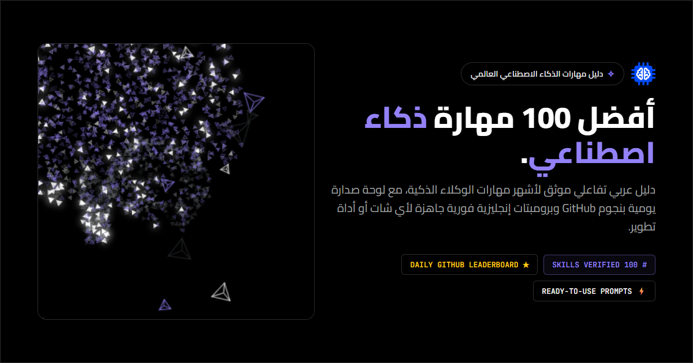

# 🏆 أفضل 100 مهارة ذكاء اصطناعي (Top 100 Agent Skills Leaderboard)
> **مستودع محدّث دوريًا يرصد ويصنّف أشهر 100 من AI Agent Skills على GitHub مع شروحات عربية وPrompts جاهزة**

<div align="center">

<p align="center">
  <a href="https://sayedgameasayed.github.io/top-100-agent-skills/">
    
  </a>
</p>

[](.github/workflows/daily-rank-sync.yml)
[](data/leaderboard.json)
[](https://sayedgameasayed.github.io/top-100-agent-skills/)
[](https://vercel.com/new/clone?repository-url=https%3A%2F%2Fgithub.com%2FSayedGameaSayed%2Ftop-100-agent-skills)
[](data/leaderboard.json)
[](LICENSE)

</div>

---

## ⚡ لماذا هذا المستودع مصدر مباشر للمستخدم؟

بدلاً من مجرد نسخ مستودعات أخرى، يعمل هذا المستودع كـ **محرك استكشاف وتصنيف آلي مستقل (Autonomous Aggregator & Leaderboard)**:
1. 🤖 **محرك استكشاف يومي (Daily Crawler):** يبحث آليًا كل 24 ساعة عبر GitHub API والمنصات المفتوحة عن أحدث AI Agent Skills (`topic:agent-skills`, `topic:claude-skills`, `SKILL.md`).
2. 📊 **ترتيب حقيقي بالنجوم والنشاط:** يجلب عدد نجوم GitHub المباشر لكل مستودع، ويصنف أعلى 100 مهارة في العالم تنازلياً.
3. 📦 **مصدر بيانات مفتوح (Public JSON API):** يوفر ملف `data/leaderboard.json` خفيف الوزن ومحدث يومياً، يمكن لأي مطور أو أداة أو إضافة IDE سحبه واستخدامه مباشرة.
4. 🌍 **شرح عربي مخصص لكل مهارة:** تبسيط وظيفة المهارة بالعربية مع Prompt إنجليزي فوري جاهز للنسخ إلى أي نموذج أو بيئة تطوير (ChatGPT, Claude, Gemini, Copilot, Cursor).
5. 🛠️ **دعم كافة أدوات التطوير والوكلاء:** توافق موثق مع Claude Code, Cursor, GitHub Copilot, Google Antigravity, Roo Code, Windsurf, و Gemini CLI.

---

## 🚀 طريقة إضافة أي مهارة إلى أداتك المفضلة

| الأداة / البيئة | طريقة التفعيل المباشرة |
|---|---|
| **Claude Code** | انسخ رابط المهارة واطلب: `Read this skill: <url>` أو أضفها عبر أمر التثبيت. |
| **Cursor IDE** | انسخ تعليمات المهارة إلى ملف `.cursorrules` أو داخل المجلد `.cursor/rules/`. |
| **Google Antigravity** | ضع ملف المهارة في `~/.gemini/antigravity/builtin/skills/<name>/SKILL.md` أو استخدم أمر `/plugin`. |
| **GitHub Copilot** | أضف نص المهارة أو رابطها داخل ملف `.github/copilot-instructions.md`. |
| **Roo Code / Cline** | ضع المهارة في مجلد التخصيصات `.roo/skills/` أو كتعليمات مخصصة Custom Instructions. |
| **أي محادثة AI (ChatGPT / Gemini / Claude)** | انسخ الـ Prompt الجاهز من لوحة الصدارة والصقه مباشرة في محادثتك. |

---

## طريقة العمل الأساسية

```text
ابحث بالعربية ──> افهم المهارة والأمثلة ──> انسخ الـ Prompt الجاهز (English) ──> الصقه في محادثتك أو بيئة التطوير
```

---

### 🏛️ معمارية المشروع والخصوصية (Hybrid Architecture & Privacy)
- **النشر الإنتاجي الكامل على Vercel ([Live Site](https://top-100-agent-skills.vercel.app/)):** يجمع بين واجهة سريعة خالية من الـ Build ودالة Serverless (`/api/advisor`) في [`api/advisor.js`](api/advisor.js) لتشغيل **مستشار المهارات الذكي** عبر توجيه الطلبات حسب التخصص (الكود، مشاريع AI، البحث العام) مع حد أقصى `1000` حرف للرسالة، وحفظ الملفات المرفوعة داخل متصفح الزائر (`localStorage`) فقط.
- **إفصاح الخصوصية (External AI Disclosure):** البحث والتصفح ولوحة الصدارة تعمل محلياً بالكامل داخل متصفحك. أما عند استخدام **مستشار المهارات الذكي** وإرسال استفسار، فإن نص السؤال ومقتطفات الملفات المختارة تُرسَل عبر HTTPS إلى مزوّدي النماذج الخارجيين (**OpenRouter / Groq / Google Gemini**) لمعالجة الترشيح فقط دون تخزين في قاعدة بيانات — لذلك يُمنع إدخال مفاتيح أو أسرار خاصة (راجع [`SECURITY.md`](SECURITY.md)).
- **المرآة الساكنة على GitHub Pages & التطوير المحلي:** الموقع يعمل أيضاً كنسخة ساكنة بالكامل مع محرك مطابقة محلي فوري (Local Specialist Fallback) إذا تعذر الوصول للخادم، كما يعمل عبر خادم Express في [`server.js`](server.js) للتطوير المحلي واختبارات التكامل (`npm run dev`).

---

## 🔌 خادم MCP مدمج لمحررات الأكواد (`npx top-100-agent-skills`)

يمكن لأي مطور ربط الدليل مباشرة مع **Claude Code / Claude Desktop / Cursor / Windsurf / Antigravity** عبر **Model Context Protocol (MCP)** بدون أي مفاتيح API (يعمل محلياً من حزمة الحوار نفسها):

```json
{
  "mcpServers": {
    "top-100-agent-skills": {
      "command": "npx",
      "args": ["-y", "top-100-agent-skills"]
    }
  }
}
```

الأدوات المتوفرة للوكيل:
- `search_skills`: بحث فوري بالعربية أو الإنجليزية مع التصفية بالتصنيف والمستوى.
- `get_skill`: جلب تفاصيل المهارة كاملة مع الرابط الرسمي على GitHub والـ Prompt الجاهز.
- `get_leaderboard`: عرض قائمة الترتيب اليومية لأعلى المهارات بالنجوم.
- `recommend_skills_for_task`: ترشيح المهارات المناسبة لمهمتك البرمجية محلياً (Zero external calls).

> 📦 **ملاحظة حول تحديث بيانات الـ MCP:** حزمة الـ npm المنشورة تشمل لقطة بيانات مدمجة ومفهرسة محلياً (`data/skills.json` و `data/leaderboard.json`) لتعمل بسرعة فائقة وبدون أي اتصال بالإنترنت؛ تتجدد هذه البيانات مع كل إصدار جديد يُنشر على npm (`npm publish`)، بينما يستمر الموقع الحي ومستودع GitHub في التحديث اليومي التلقائي للنجوم والمهارات عبر GitHub Actions.

---

## تشغيل المشروع محلياً

1. استنسخ المستودع وثبّت الحزم:
   ```bash
   git clone https://github.com/SayedGameaSayed/top-100-agent-skills.git
   cd top-100-agent-skills
   npm install
   ```
2. شغّل الخادم المحلي واختبر الـ API:
   ```bash
   npm run dev
   ```
3. أو افتح الموقع مباشرة عبر خادم ملفات على `http://localhost:3000/`.

---

## التحقق والاختبارات (Validator & Test Suite)

يحتوي المستودع على اختبارات صارمة للبيانات والخادم والـ MCP:
```bash
node scripts/validate.mjs
npm test
```

---

<div dir="ltr">

## English Overview

**Top 100 AI Agent Skills** is an open-source, bilingual (English-default + Arabic RTL) directory, daily GitHub star leaderboard, and **Model Context Protocol (MCP) server** for curated `SKILL.md` agent skills.

### Key Highlights:
- **Zero-Key AI Skills Advisor + Local Fallback:** Deployed on Vercel with [`api/advisor.js`](api/advisor.js) routing coding, AI architecture, and general discovery queries to free-tier specialists (**OpenRouter / Groq / Google Gemini**), alongside an instant client-side semantic fallback when offline or on static mirrors.
- **Transparent Privacy & Abuse Controls:** Catalog search and leaderboard run purely in-browser; submitted advisor prompts (capped at 1,000 chars) and optional browser-`localStorage` code snippets (max 3 files, 50 KB each) are forwarded only for inference and never stored in a database. See [`SECURITY.md`](SECURITY.md).
- **MCP Server (`npx` ready):** Expose `search_skills`, `get_skill`, `get_leaderboard`, and offline `recommend_skills_for_task` directly inside Claude Code, Cursor, Antigravity, or Claude Desktop via `node bin/mcp.js` or `npx -y top-100-agent-skills`. *(Note: The npm package ships with a bundled zero-latency local data snapshot updated on each npm release; the live website and GitHub repo continue syncing daily via GitHub Actions).*
- **Strict Licensing:** Proprietary skills never have files copied into this repo; permissive derived skills retain upstream attributions.

### Running & Testing:
```bash
# Install dependencies & validate catalog rules
npm install
node scripts/validate.mjs

# Run full validation, search, server security, governance & MCP tests
npm test

# Start local Express + API server
npm run dev
```

Licensed under [MIT](LICENSE). Attributions in [NOTICE.md](NOTICE.md).
</div>


## 🏆 قائمة المتصدرين لأفضل 100 مهارة ذكاء اصطناعي (Top 100 Leaderboard)

<!-- LEADERBOARD_START -->
> 🔄 **آخر تحديث آلي:** 2026-11-12 | **التصنيف:** الأكثر شهرة (حسب نجوم المستودع) | [تحميل JSON المباشر](data/leaderboard.json)
> ⚠️ **تنبيه:** عدد النجوم يعود لمستودع GitHub الأصلي بالكامل وليس للمهارة المنفصلة بمفردها.

| # | نجوم المستودع ★ | المهارة (Skill) | التصنيف | المستودع الأصلي (GitHub) | الشرح والبرومبت الجاهز | حالة المراجعة |
|:---:|:---:|---|---|---|:---:|:---:|
| **🥇 1** | `322.7k` | [**diagnosing-bugs**](https://github.com/mattpocock/skills/tree/main/skills/engineering/diagnosing-bugs) | جودة الكود والاختبار | [`mattpocock/skills`](https://github.com/mattpocock/skills) | [**حلقة التشخيص المنهجي للأخطاء البرمجية الصعبة** ↗](https://sayedgameasayed.github.io/top-100-agent-skills/skill.html?id=mp-diagnosing-bugs) | ✅ مراجعة يدوية |
| **🥈 2** | `322.7k` | [**grill-with-docs**](https://github.com/mattpocock/skills/tree/main/skills/engineering/grill-with-docs) | البرمجة والويب | [`mattpocock/skills`](https://github.com/mattpocock/skills) | [**المقابلة الاستقصائية وتوليد توثيق القرارات المعمارية** ↗](https://sayedgameasayed.github.io/top-100-agent-skills/skill.html?id=grill-with-docs) | ✅ مراجعة يدوية |
| **🥉 3** | `322.7k` | [**triage**](https://github.com/mattpocock/skills/tree/main/skills/engineering/triage) | جودة الكود والاختبار | [`mattpocock/skills`](https://github.com/mattpocock/skills) | [**فرز وتصنيف المشاكل وطلبات السحب برمجيًا** ↗](https://sayedgameasayed.github.io/top-100-agent-skills/skill.html?id=triage) | ✅ مراجعة يدوية |
| **#4** | `322.7k` | [**improve-codebase-architecture**](https://github.com/mattpocock/skills/tree/main/skills/engineering/improve-codebase-architecture) | البرمجة والويب | [`mattpocock/skills`](https://github.com/mattpocock/skills) | [**مسح وتعميق البنية المعمارية للكود البرمجي** ↗](https://sayedgameasayed.github.io/top-100-agent-skills/skill.html?id=improve-codebase-architecture) | ✅ مراجعة يدوية |
| **#5** | `322.7k` | [**tdd**](https://github.com/mattpocock/skills/tree/main/skills/engineering/tdd) | جودة الكود والاختبار | [`mattpocock/skills`](https://github.com/mattpocock/skills) | [**التطوير الموجه بالاختبارات الصارم من مات بوكوك** ↗](https://sayedgameasayed.github.io/top-100-agent-skills/skill.html?id=mp-tdd) | ✅ مراجعة يدوية |
| **#6** | `322.7k` | [**to-tickets**](https://github.com/mattpocock/skills/tree/main/skills/engineering/to-tickets) | البرمجة والويب | [`mattpocock/skills`](https://github.com/mattpocock/skills) | [**تقسيم الخطط الكبيرة إلى تذاكر برمجية مترابطة** ↗](https://sayedgameasayed.github.io/top-100-agent-skills/skill.html?id=to-tickets) | ✅ مراجعة يدوية |
| **#7** | `322.7k` | [**to-spec**](https://github.com/mattpocock/skills/tree/main/skills/engineering/to-spec) | البرمجة والويب | [`mattpocock/skills`](https://github.com/mattpocock/skills) | [**صياغة وثائق المواصفات الفنية من سياق النقاش** ↗](https://sayedgameasayed.github.io/top-100-agent-skills/skill.html?id=to-spec) | ✅ مراجعة يدوية |
| **#8** | `322.7k` | [**grill-me**](https://github.com/mattpocock/skills/tree/main/skills/productivity/grill-me) | البرمجة والويب | [`mattpocock/skills`](https://github.com/mattpocock/skills) | [**المراجعة الاستقصائية الصارمة لاختبار الأفكار والخطط** ↗](https://sayedgameasayed.github.io/top-100-agent-skills/skill.html?id=grill-me) | ✅ مراجعة يدوية |
| **#9** | `322.7k` | [**setup-pre-commit**](https://github.com/mattpocock/skills/tree/main/skills/misc/setup-pre-commit) | جودة الكود والاختبار | [`mattpocock/skills`](https://github.com/mattpocock/skills) | [**تهيئة خطافات Husky وفحص الأكواد قبل الاعتماد** ↗](https://sayedgameasayed.github.io/top-100-agent-skills/skill.html?id=setup-pre-commit) | ✅ مراجعة يدوية |
| **#10** | `322.7k` | [**git-guardrails-claude-code**](https://github.com/mattpocock/skills/tree/main/skills/misc/git-guardrails-claude-code) | البرمجة والويب | [`mattpocock/skills`](https://github.com/mattpocock/skills) | [**حواجز حماية أوامر Git الخطرة لوكلاء الذكاء الاصطناعي** ↗](https://sayedgameasayed.github.io/top-100-agent-skills/skill.html?id=git-guardrails-claude-code) | ✅ مراجعة يدوية |
| **#11** | `322.7k` | [**writing-for-agents**](https://github.com/mattpocock/skills/tree/main/skills/productivity/writing-for-agents) | الكتابة والتواصل | [`mattpocock/skills`](https://github.com/mattpocock/skills) | [**كتابة المستندات والتعليمات الموجهة لوكلاء الذكاء الاصطناعي** ↗](https://sayedgameasayed.github.io/top-100-agent-skills/skill.html?id=writing-for-agents) | ✅ مراجعة يدوية |
| **#12** | `322.7k` | [**codebase-design**](https://github.com/mattpocock/skills/tree/main/skills/engineering/codebase-design) | البرمجة والويب | [`mattpocock/skills`](https://github.com/mattpocock/skills) | [**تصميم وبناء الوحدات البرمجية العميقة** ↗](https://sayedgameasayed.github.io/top-100-agent-skills/skill.html?id=codebase-design) | ✅ مراجعة يدوية |
| **#13** | `322.7k` | [**code-review**](https://github.com/mattpocock/skills/tree/main/skills/engineering/code-review) | جودة الكود والاختبار | [`mattpocock/skills`](https://github.com/mattpocock/skills) | [**المراجعة المعيارية الدقيقة لتغييرات الكود** ↗](https://sayedgameasayed.github.io/top-100-agent-skills/skill.html?id=mp-code-review) | ✅ مراجعة يدوية |
| **#14** | `316.6k` | [**writing-plans**](https://github.com/obra/superpowers/tree/main/skills/writing-plans) | البرمجة والويب | [`obra/superpowers`](https://github.com/obra/superpowers) | [**تخطيط المشاريع البرمجية خطوة بخطوة** ↗](https://sayedgameasayed.github.io/top-100-agent-skills/skill.html?id=obra-writing-plans) | ✅ مراجعة يدوية |
| **#15** | `316.6k` | [**systematic-debugging**](https://github.com/obra/superpowers/tree/main/skills/systematic-debugging) | جودة الكود والاختبار | [`obra/superpowers`](https://github.com/obra/superpowers) | [**استكشاف وإصلاح الأخطاء المنهجي** ↗](https://sayedgameasayed.github.io/top-100-agent-skills/skill.html?id=systematic-debugging) | ✅ مراجعة يدوية |
| **#16** | `316.6k` | [**test-driven-development**](https://github.com/obra/superpowers/tree/main/skills/test-driven-development) | جودة الكود والاختبار | [`obra/superpowers`](https://github.com/obra/superpowers) | [**التطوير الموجه بالاختبارات (TDD)** ↗](https://sayedgameasayed.github.io/top-100-agent-skills/skill.html?id=test-driven-development) | ✅ مراجعة يدوية |
| **#17** | `316.6k` | [**requesting-code-review**](https://github.com/obra/superpowers/tree/main/skills/requesting-code-review) | جودة الكود والاختبار | [`obra/superpowers`](https://github.com/obra/superpowers) | [**إعداد الكود وطلب المراجعة البرمجية** ↗](https://sayedgameasayed.github.io/top-100-agent-skills/skill.html?id=requesting-code-review) | ✅ مراجعة يدوية |
| **#18** | `316.6k` | [**receiving-code-review**](https://github.com/obra/superpowers/tree/main/skills/receiving-code-review) | جودة الكود والاختبار | [`obra/superpowers`](https://github.com/obra/superpowers) | [**استيعاب وتطبيق ملاحظات مراجعة الكود** ↗](https://sayedgameasayed.github.io/top-100-agent-skills/skill.html?id=receiving-code-review) | ✅ مراجعة يدوية |
| **#19** | `316.6k` | [**using-git-worktrees**](https://github.com/obra/superpowers/tree/main/skills/using-git-worktrees) | جودة الكود والاختبار | [`obra/superpowers`](https://github.com/obra/superpowers) | [**العمل على عدة فروع بالتوازي بـ Git Worktrees** ↗](https://sayedgameasayed.github.io/top-100-agent-skills/skill.html?id=using-git-worktrees) | ✅ مراجعة يدوية |
| **#20** | `316.6k` | [**verification-before-completion**](https://github.com/obra/superpowers/tree/main/skills/verification-before-completion) | جودة الكود والاختبار | [`obra/superpowers`](https://github.com/obra/superpowers) | [**التحقق الصارم قبل إنهاء المهمة** ↗](https://sayedgameasayed.github.io/top-100-agent-skills/skill.html?id=verification-before-completion) | ✅ مراجعة يدوية |
| **#21** | `316.6k` | [**subagent-driven-development**](https://github.com/obra/superpowers/tree/main/skills/subagent-driven-development) | بناء المهارات واكتشافها | [`obra/superpowers`](https://github.com/obra/superpowers) | [**تطوير المشاريع عبر فرق الوكلاء الفرعيين** ↗](https://sayedgameasayed.github.io/top-100-agent-skills/skill.html?id=subagent-driven-development) | ✅ مراجعة يدوية |
| **#22** | `316.6k` | [**executing-plans**](https://github.com/obra/superpowers/tree/main/skills/executing-plans) | بناء المهارات واكتشافها | [`obra/superpowers`](https://github.com/obra/superpowers) | [**التنفيذ المنضبط لخطط العمل البرمجية** ↗](https://sayedgameasayed.github.io/top-100-agent-skills/skill.html?id=executing-plans) | ✅ مراجعة يدوية |
| **#23** | `316.6k` | [**dispatching-parallel-agents**](https://github.com/obra/superpowers/tree/main/skills/dispatching-parallel-agents) | بناء المهارات واكتشافها | [`obra/superpowers`](https://github.com/obra/superpowers) | [**إطلاق وتنسيق الوكلاء المتوازيين** ↗](https://sayedgameasayed.github.io/top-100-agent-skills/skill.html?id=dispatching-parallel-agents) | ✅ مراجعة يدوية |
| **#24** | `316.6k` | [**brainstorming-solutions**](https://github.com/obra/superpowers/tree/main/skills/brainstorming) | بناء المهارات واكتشافها | [`obra/superpowers`](https://github.com/obra/superpowers) | [**العصف الذهني واستكشاف الحلول المعمارية** ↗](https://sayedgameasayed.github.io/top-100-agent-skills/skill.html?id=brainstorming-solutions) | ✅ مراجعة يدوية |
| **#25** | `316.6k` | [**finishing-a-development-branch**](https://github.com/obra/superpowers/tree/main/skills/finishing-a-development-branch) | جودة الكود والاختبار | [`obra/superpowers`](https://github.com/obra/superpowers) | [**إنهاء فرع التطوير والدمج الآمن** ↗](https://sayedgameasayed.github.io/top-100-agent-skills/skill.html?id=finishing-development-branch) | ✅ مراجعة يدوية |
| **#26** | `316.6k` | [**using-superpowers**](https://github.com/obra/superpowers/tree/main/skills/using-superpowers) | بناء المهارات واكتشافها | [`obra/superpowers`](https://github.com/obra/superpowers) | [**الاستدعاء التلقائي لمهارات الوكلاء** ↗](https://sayedgameasayed.github.io/top-100-agent-skills/skill.html?id=using-superpowers) | ✅ مراجعة يدوية |
| **#27** | `316.6k` | [**diagnosing-superpowers**](https://github.com/obra/superpowers/tree/main/skills/diagnosing-superpowers) | جودة الكود والاختبار | [`obra/superpowers`](https://github.com/obra/superpowers) | [**تشخيص ومعالجة انحراف الجلسات** ↗](https://sayedgameasayed.github.io/top-100-agent-skills/skill.html?id=diagnosing-superpowers) | ✅ مراجعة يدوية |
| **#28** | `316.6k` | [**writing-skills**](https://github.com/obra/superpowers/tree/main/skills/writing-skills) | بناء المهارات واكتشافها | [`obra/superpowers`](https://github.com/obra/superpowers) | [**تأليف واختبار مهارات الوكلاء الجديدة** ↗](https://sayedgameasayed.github.io/top-100-agent-skills/skill.html?id=writing-skills) | ✅ مراجعة يدوية |
| **#29** | `301.8k` | [**fastapi-patterns**](https://github.com/affaan-m/ECC/tree/main/skills/fastapi-patterns) | البرمجة والويب | [`affaan-m/ECC`](https://github.com/affaan-m/ECC) | [**أنماط واجهات FastAPI المتقدمة** ↗](https://sayedgameasayed.github.io/top-100-agent-skills/skill.html?id=fastapi-patterns) | ✅ مراجعة يدوية |
| **#30** | `301.8k` | [**prisma-patterns**](https://github.com/affaan-m/ECC/tree/main/skills/prisma-patterns) | البرمجة والويب | [`affaan-m/ECC`](https://github.com/affaan-m/ECC) | [**استعلامات ونمذجة Prisma ORM الحديثة** ↗](https://sayedgameasayed.github.io/top-100-agent-skills/skill.html?id=prisma-patterns) | ✅ مراجعة يدوية |
| **#31** | `301.8k` | [**swiftui-patterns**](https://github.com/affaan-m/ECC/tree/main/skills/swiftui-patterns) | البرمجة والويب | [`affaan-m/ECC`](https://github.com/affaan-m/ECC) | [**أنماط واجهات SwiftUI التفاعلية** ↗](https://sayedgameasayed.github.io/top-100-agent-skills/skill.html?id=swiftui-patterns) | ✅ مراجعة يدوية |
| **#32** | `301.8k` | [**rust-patterns**](https://github.com/affaan-m/ECC/tree/main/skills/rust-patterns) | البرمجة والويب | [`affaan-m/ECC`](https://github.com/affaan-m/ECC) | [**أنماط الإنتاج في لغة Rust** ↗](https://sayedgameasayed.github.io/top-100-agent-skills/skill.html?id=rust-patterns) | ✅ مراجعة يدوية |
| **#33** | `301.8k` | [**redis-patterns**](https://github.com/affaan-m/ECC/tree/main/skills/redis-patterns) | البرمجة والويب | [`affaan-m/ECC`](https://github.com/affaan-m/ECC) | [**أنماط التخزين المؤقت بـ Redis** ↗](https://sayedgameasayed.github.io/top-100-agent-skills/skill.html?id=redis-patterns) | ✅ مراجعة يدوية |
| **#34** | `301.8k` | [**react-testing-library**](https://github.com/affaan-m/ECC/tree/main/skills/react-testing) | جودة الكود والاختبار | [`affaan-m/ECC`](https://github.com/affaan-m/ECC) | [**اختبار مكونات React التفاعلية** ↗](https://sayedgameasayed.github.io/top-100-agent-skills/skill.html?id=react-testing-library) | ✅ مراجعة يدوية |
| **#35** | `301.8k` | [**python-pytest-suite**](https://github.com/affaan-m/ECC/tree/main/skills/python-testing) | جودة الكود والاختبار | [`affaan-m/ECC`](https://github.com/affaan-m/ECC) | [**حزمة اختبارات Python عبر Pytest** ↗](https://sayedgameasayed.github.io/top-100-agent-skills/skill.html?id=python-pytest-suite) | ✅ مراجعة يدوية |
| **#36** | `301.8k` | [**django-security**](https://github.com/affaan-m/ECC/tree/main/skills/django-security) | السحابة والأمان | [`affaan-m/ECC`](https://github.com/affaan-m/ECC) | [**تحصين وأمان تطبيقات Django** ↗](https://sayedgameasayed.github.io/top-100-agent-skills/skill.html?id=django-security) | ✅ مراجعة يدوية |
| **#37** | `301.8k` | [**springboot-security**](https://github.com/affaan-m/ECC/tree/main/skills/springboot-security) | السحابة والأمان | [`affaan-m/ECC`](https://github.com/affaan-m/ECC) | [**تأمين تطبيقات Spring Boot و Java** ↗](https://sayedgameasayed.github.io/top-100-agent-skills/skill.html?id=springboot-security) | ✅ مراجعة يدوية |
| **#38** | `301.8k` | [**security-review-checklist**](https://github.com/affaan-m/ECC/tree/main/skills/security-review) | السحابة والأمان | [`affaan-m/ECC`](https://github.com/affaan-m/ECC) | [**قائمة التدقيق الأمني الشامل للكود** ↗](https://sayedgameasayed.github.io/top-100-agent-skills/skill.html?id=security-review-checklist) | ✅ مراجعة يدوية |
| **#39** | `301.8k` | [**pytorch-model-eval**](https://github.com/affaan-m/ECC/tree/main/skills/pytorch-patterns) | البيانات والذكاء الاصطناعي | [`affaan-m/ECC`](https://github.com/affaan-m/ECC) | [**أنماط وتقييم نماذج PyTorch للتعلم العميق** ↗](https://sayedgameasayed.github.io/top-100-agent-skills/skill.html?id=pytorch-model-eval) | ✅ مراجعة يدوية |
| **#40** | `301.8k` | [**marketing-campaign**](https://github.com/affaan-m/ECC/tree/main/skills/marketing-campaign) | الأعمال والمال | [`affaan-m/ECC`](https://github.com/affaan-m/ECC) | [**تخطيط وتنفيذ الحملات التسويقية الرقمية** ↗](https://sayedgameasayed.github.io/top-100-agent-skills/skill.html?id=marketing-campaign) | ✅ مراجعة يدوية |
| **#41** | `301.8k` | [**i18n-sync-manager**](https://github.com/affaan-m/ECC/tree/main/skills/i18n-sync) | الكتابة والتواصل | [`affaan-m/ECC`](https://github.com/affaan-m/ECC) | [**مزامنة وتدقيق ملفات الترجمة الدولية (i18n)** ↗](https://sayedgameasayed.github.io/top-100-agent-skills/skill.html?id=i18n-sync-manager) | ✅ مراجعة يدوية |
| **#42** | `301.8k` | [**golang-testing-suite**](https://github.com/affaan-m/ECC/tree/main/skills/golang-testing) | جودة الكود والاختبار | [`affaan-m/ECC`](https://github.com/affaan-m/ECC) | [**اختبارات Go وحساب الأداء (Benchmarks)** ↗](https://sayedgameasayed.github.io/top-100-agent-skills/skill.html?id=golang-testing-suite) | ✅ مراجعة يدوية |
| **#43** | `301.8k` | [**eval-harness**](https://github.com/affaan-m/ECC/tree/main/skills/eval-harness) | جودة الكود والاختبار | [`affaan-m/ECC`](https://github.com/affaan-m/ECC) | [**أطر تقييم مخرجات نماذج الذكاء الاصطناعي** ↗](https://sayedgameasayed.github.io/top-100-agent-skills/skill.html?id=eval-harness) | ✅ مراجعة يدوية |
| **#44** | `193.5k` | [**pdf**](https://github.com/anthropics/skills/tree/main/skills/pdf) | المستندات والملفات | [`anthropics/skills`](https://github.com/anthropics/skills) | [**التعامل مع ملفات PDF** ↗](https://sayedgameasayed.github.io/top-100-agent-skills/skill.html?id=pdf) | ✅ مراجعة يدوية |
| **#45** | `193.5k` | [**docx**](https://github.com/anthropics/skills/tree/main/skills/docx) | المستندات والملفات | [`anthropics/skills`](https://github.com/anthropics/skills) | [**إنشاء وتعديل ملفات Word** ↗](https://sayedgameasayed.github.io/top-100-agent-skills/skill.html?id=docx) | ✅ مراجعة يدوية |
| **#46** | `193.5k` | [**xlsx**](https://github.com/anthropics/skills/tree/main/skills/xlsx) | المستندات والملفات | [`anthropics/skills`](https://github.com/anthropics/skills) | [**جداول Excel والتحليل** ↗](https://sayedgameasayed.github.io/top-100-agent-skills/skill.html?id=xlsx) | ✅ مراجعة يدوية |
| **#47** | `193.5k` | [**pptx**](https://github.com/anthropics/skills/tree/main/skills/pptx) | المستندات والملفات | [`anthropics/skills`](https://github.com/anthropics/skills) | [**إنشاء وتعديل عروض PowerPoint** ↗](https://sayedgameasayed.github.io/top-100-agent-skills/skill.html?id=pptx) | ✅ مراجعة يدوية |
| **#48** | `193.5k` | [**frontend-design**](https://github.com/anthropics/skills/tree/main/skills/frontend-design) | التصميم والإبداع | [`anthropics/skills`](https://github.com/anthropics/skills) | [**تصميم واجهات ويب مميزة** ↗](https://sayedgameasayed.github.io/top-100-agent-skills/skill.html?id=frontend-design) | ✅ مراجعة يدوية |
| **#49** | `193.5k` | [**skill-creator**](https://github.com/anthropics/skills/tree/main/skills/skill-creator) | بناء المهارات واكتشافها | [`anthropics/skills`](https://github.com/anthropics/skills) | [**صانع المهارات** ↗](https://sayedgameasayed.github.io/top-100-agent-skills/skill.html?id=skill-creator) | ✅ مراجعة يدوية |
| **#50** | `193.5k` | [**webapp-testing**](https://github.com/anthropics/skills/tree/main/skills/webapp-testing) | جودة الكود والاختبار | [`anthropics/skills`](https://github.com/anthropics/skills) | [**اختبار تطبيقات الويب** ↗](https://sayedgameasayed.github.io/top-100-agent-skills/skill.html?id=webapp-testing) | ✅ مراجعة يدوية |
| **#51** | `193.5k` | [**mcp-builder**](https://github.com/anthropics/skills/tree/main/skills/mcp-builder) | البرمجة والويب | [`anthropics/skills`](https://github.com/anthropics/skills) | [**بناء خوادم MCP** ↗](https://sayedgameasayed.github.io/top-100-agent-skills/skill.html?id=mcp-builder) | ✅ مراجعة يدوية |
| **#52** | `193.5k` | [**canvas-design**](https://github.com/anthropics/skills/tree/main/skills/canvas-design) | التصميم والإبداع | [`anthropics/skills`](https://github.com/anthropics/skills) | [**تصميم بوسترات وفنون ثابتة** ↗](https://sayedgameasayed.github.io/top-100-agent-skills/skill.html?id=canvas-design) | ✅ مراجعة يدوية |
| **#53** | `193.5k` | [**web-artifacts-builder**](https://github.com/anthropics/skills/tree/main/skills/web-artifacts-builder) | البرمجة والويب | [`anthropics/skills`](https://github.com/anthropics/skills) | [**بناء صفحات ويب متقدمة** ↗](https://sayedgameasayed.github.io/top-100-agent-skills/skill.html?id=web-artifacts-builder) | ✅ مراجعة يدوية |
| **#54** | `193.5k` | [**brand-guidelines**](https://github.com/anthropics/skills/tree/main/skills/brand-guidelines) | التصميم والإبداع | [`anthropics/skills`](https://github.com/anthropics/skills) | [**تطبيق الهوية البصرية** ↗](https://sayedgameasayed.github.io/top-100-agent-skills/skill.html?id=brand-guidelines) | ✅ مراجعة يدوية |
| **#55** | `193.5k` | [**theme-factory**](https://github.com/anthropics/skills/tree/main/skills/theme-factory) | التصميم والإبداع | [`anthropics/skills`](https://github.com/anthropics/skills) | [**مظاهر جاهزة للعروض والمستندات** ↗](https://sayedgameasayed.github.io/top-100-agent-skills/skill.html?id=theme-factory) | ✅ مراجعة يدوية |
| **#56** | `193.5k` | [**doc-coauthoring**](https://github.com/anthropics/skills/tree/main/skills/doc-coauthoring) | الكتابة والتواصل | [`anthropics/skills`](https://github.com/anthropics/skills) | [**كتابة المستندات بالمشاركة** ↗](https://sayedgameasayed.github.io/top-100-agent-skills/skill.html?id=doc-coauthoring) | ✅ مراجعة يدوية |
| **#57** | `193.5k` | [**algorithmic-art**](https://github.com/anthropics/skills/tree/main/skills/algorithmic-art) | التصميم والإبداع | [`anthropics/skills`](https://github.com/anthropics/skills) | [**فن توليدي بالكود** ↗](https://sayedgameasayed.github.io/top-100-agent-skills/skill.html?id=algorithmic-art) | ✅ مراجعة يدوية |
| **#58** | `193.5k` | [**internal-comms**](https://github.com/anthropics/skills/tree/main/skills/internal-comms) | الكتابة والتواصل | [`anthropics/skills`](https://github.com/anthropics/skills) | [**التواصل الداخلي في الشركات** ↗](https://sayedgameasayed.github.io/top-100-agent-skills/skill.html?id=internal-comms) | ✅ مراجعة يدوية |
| **#59** | `193.5k` | [**slack-gif-creator**](https://github.com/anthropics/skills/tree/main/skills/slack-gif-creator) | التصميم والإبداع | [`anthropics/skills`](https://github.com/anthropics/skills) | [**صور GIF متحركة لـ Slack** ↗](https://sayedgameasayed.github.io/top-100-agent-skills/skill.html?id=slack-gif-creator) | ✅ مراجعة يدوية |
| **#60** | `193.5k` | [**claude-api**](https://github.com/anthropics/skills/tree/main/skills/claude-api) | البرمجة والويب | [`anthropics/skills`](https://github.com/anthropics/skills) | [**البناء باستخدام Claude API** ↗](https://sayedgameasayed.github.io/top-100-agent-skills/skill.html?id=claude-api) | ✅ مراجعة يدوية |
| **#61** | `116.4k` | [**interview-me**](https://github.com/addyosmani/agent-skills/tree/main/skills/interview-me) | الكتابة والتواصل | [`addyosmani/agent-skills`](https://github.com/addyosmani/agent-skills) | [**استخلاص المتطلبات بالحوار المتدرج** ↗](https://sayedgameasayed.github.io/top-100-agent-skills/skill.html?id=interview-me) | ✅ مراجعة يدوية |
| **#62** | `116.4k` | [**idea-refine**](https://github.com/addyosmani/agent-skills/tree/main/skills/idea-refine) | الكتابة والتواصل | [`addyosmani/agent-skills`](https://github.com/addyosmani/agent-skills) | [**بلورة وتطوير الأفكار التقنية** ↗](https://sayedgameasayed.github.io/top-100-agent-skills/skill.html?id=idea-refine) | ✅ مراجعة يدوية |
| **#63** | `116.4k` | [**spec-driven-development**](https://github.com/addyosmani/agent-skills/tree/main/skills/spec-driven-development) | جودة الكود والاختبار | [`addyosmani/agent-skills`](https://github.com/addyosmani/agent-skills) | [**التطوير المدفوع بالمواصفات التقنية** ↗](https://sayedgameasayed.github.io/top-100-agent-skills/skill.html?id=spec-driven-development) | ✅ مراجعة يدوية |
| **#64** | `116.4k` | [**planning-and-task-breakdown**](https://github.com/addyosmani/agent-skills/tree/main/skills/planning-and-task-breakdown) | جودة الكود والاختبار | [`addyosmani/agent-skills`](https://github.com/addyosmani/agent-skills) | [**تفكيك المهام وتخطيط التسليم** ↗](https://sayedgameasayed.github.io/top-100-agent-skills/skill.html?id=planning-and-task-breakdown) | ✅ مراجعة يدوية |
| **#65** | `116.4k` | [**incremental-implementation**](https://github.com/addyosmani/agent-skills/tree/main/skills/incremental-implementation) | البرمجة والويب | [`addyosmani/agent-skills`](https://github.com/addyosmani/agent-skills) | [**التنفيذ التدريجي بالشرائح القابلة للتحقق** ↗](https://sayedgameasayed.github.io/top-100-agent-skills/skill.html?id=incremental-implementation) | ✅ مراجعة يدوية |
| **#66** | `116.4k` | [**frontend-ui-engineering**](https://github.com/addyosmani/agent-skills/tree/main/skills/frontend-ui-engineering) | التصميم والإبداع | [`addyosmani/agent-skills`](https://github.com/addyosmani/agent-skills) | [**هندسة واجهات المستخدم الإنتاجية** ↗](https://sayedgameasayed.github.io/top-100-agent-skills/skill.html?id=frontend-ui-engineering) | ✅ مراجعة يدوية |
| **#67** | `116.4k` | [**api-and-interface-design**](https://github.com/addyosmani/agent-skills/tree/main/skills/api-and-interface-design) | البرمجة والويب | [`addyosmani/agent-skills`](https://github.com/addyosmani/agent-skills) | [**تصميم واجهات البرمجة (APIs) والحدود المعمارية** ↗](https://sayedgameasayed.github.io/top-100-agent-skills/skill.html?id=api-and-interface-design) | ✅ مراجعة يدوية |
| **#68** | `116.4k` | [**context-engineering**](https://github.com/addyosmani/agent-skills/tree/main/skills/context-engineering) | بناء المهارات واكتشافها | [`addyosmani/agent-skills`](https://github.com/addyosmani/agent-skills) | [**هندسة سياق الوكلاء وإدارة الذاكرة** ↗](https://sayedgameasayed.github.io/top-100-agent-skills/skill.html?id=context-engineering) | ✅ مراجعة يدوية |
| **#69** | `116.4k` | [**browser-testing-with-devtools**](https://github.com/addyosmani/agent-skills/tree/main/skills/browser-testing-with-devtools) | جودة الكود والاختبار | [`addyosmani/agent-skills`](https://github.com/addyosmani/agent-skills) | [**الاختبار الآلي للمتصفح عبر DevTools** ↗](https://sayedgameasayed.github.io/top-100-agent-skills/skill.html?id=browser-testing-devtools) | ✅ مراجعة يدوية |
| **#70** | `116.4k` | [**debugging-and-error-recovery**](https://github.com/addyosmani/agent-skills/tree/main/skills/debugging-and-error-recovery) | جودة الكود والاختبار | [`addyosmani/agent-skills`](https://github.com/addyosmani/agent-skills) | [**التشخيص الجذري للأخطاء والتعافي الذاتي** ↗](https://sayedgameasayed.github.io/top-100-agent-skills/skill.html?id=debugging-error-recovery) | ✅ مراجعة يدوية |
| **#71** | `116.4k` | [**doubt-driven-development**](https://github.com/addyosmani/agent-skills/tree/main/skills/doubt-driven-development) | جودة الكود والاختبار | [`addyosmani/agent-skills`](https://github.com/addyosmani/agent-skills) | [**المراجعة المعارضة واختبار الافتراضات** ↗](https://sayedgameasayed.github.io/top-100-agent-skills/skill.html?id=doubt-driven-development) | ✅ مراجعة يدوية |
| **#72** | `116.4k` | [**source-driven-development**](https://github.com/addyosmani/agent-skills/tree/main/skills/source-driven-development) | البرمجة والويب | [`addyosmani/agent-skills`](https://github.com/addyosmani/agent-skills) | [**التطوير المرتكز على التوثيق والمصادر الرسمية** ↗](https://sayedgameasayed.github.io/top-100-agent-skills/skill.html?id=source-driven-development) | ✅ مراجعة يدوية |
| **#73** | `116.4k` | [**constraint-driven-development**](https://github.com/addyosmani/agent-skills/tree/main/skills/constraint-driven-development) | جودة الكود والاختبار | [`addyosmani/agent-skills`](https://github.com/addyosmani/agent-skills) | [**التطوير المنضبط بالقيود الهندسية الصارمة** ↗](https://sayedgameasayed.github.io/top-100-agent-skills/skill.html?id=constraint-driven-development) | ✅ مراجعة يدوية |
| **#74** | `116.4k` | [**code-review-and-quality**](https://github.com/addyosmani/agent-skills/tree/main/skills/code-review-and-quality) | جودة الكود والاختبار | [`addyosmani/agent-skills`](https://github.com/addyosmani/agent-skills) | [**المراجعة الشاملة لجودة الكود والأمان** ↗](https://sayedgameasayed.github.io/top-100-agent-skills/skill.html?id=code-review-quality) | ✅ مراجعة يدوية |
| **#75** | `116.4k` | [**code-simplification**](https://github.com/addyosmani/agent-skills/tree/main/skills/code-simplification) | البرمجة والويب | [`addyosmani/agent-skills`](https://github.com/addyosmani/agent-skills) | [**تبسيط الكود وتطهيره من التعقيد الزائد** ↗](https://sayedgameasayed.github.io/top-100-agent-skills/skill.html?id=code-simplification) | ✅ مراجعة يدوية |
| **#76** | `116.4k` | [**performance-optimization**](https://github.com/addyosmani/agent-skills/tree/main/skills/performance-optimization) | البرمجة والويب | [`addyosmani/agent-skills`](https://github.com/addyosmani/agent-skills) | [**تسريع وتحسين أداء التطبيقات وقواعد البيانات** ↗](https://sayedgameasayed.github.io/top-100-agent-skills/skill.html?id=performance-optimization) | ✅ مراجعة يدوية |
| **#77** | `116.4k` | [**deprecation-and-migration**](https://github.com/addyosmani/agent-skills/tree/main/skills/deprecation-and-migration) | البرمجة والويب | [`addyosmani/agent-skills`](https://github.com/addyosmani/agent-skills) | [**إدارة الترحيل البرمجي (Migration) والأنظمة المتوقفة** ↗](https://sayedgameasayed.github.io/top-100-agent-skills/skill.html?id=deprecation-migration) | ✅ مراجعة يدوية |
| **#78** | `116.4k` | [**git-workflow-and-versioning**](https://github.com/addyosmani/agent-skills/tree/main/skills/git-workflow-and-versioning) | البرمجة والويب | [`addyosmani/agent-skills`](https://github.com/addyosmani/agent-skills) | [**إدارة إصدارات Git والترقيم الدلالي** ↗](https://sayedgameasayed.github.io/top-100-agent-skills/skill.html?id=git-workflow-versioning) | ✅ مراجعة يدوية |
| **#79** | `116.4k` | [**shipping-and-launch**](https://github.com/addyosmani/agent-skills/tree/main/skills/shipping-and-launch) | السحابة والأمان | [`addyosmani/agent-skills`](https://github.com/addyosmani/agent-skills) | [**جاهزية الإطلاق والتدقيق النهائي للنشر** ↗](https://sayedgameasayed.github.io/top-100-agent-skills/skill.html?id=shipping-and-launch) | ✅ مراجعة يدوية |
| **#80** | `56.6k` | [**deep-research**](https://github.com/Imbad0202/academic-research-skills/tree/main/deep-research) | العلوم والتعليم | [`Imbad0202/academic-research-skills`](https://github.com/Imbad0202/academic-research-skills) | [**فريق البحث الأكاديمي والتحليل المنهجي المعمق** ↗](https://sayedgameasayed.github.io/top-100-agent-skills/skill.html?id=deep-research) | ✅ مراجعة يدوية |
| **#81** | `56.6k` | [**sr-screener**](https://github.com/Imbad0202/academic-research-skills/tree/main/sr-screener) | العلوم والتعليم | [`Imbad0202/academic-research-skills`](https://github.com/Imbad0202/academic-research-skills) | [**فرز الأوراق العلمية للمراجعات المنهجية** ↗](https://sayedgameasayed.github.io/top-100-agent-skills/skill.html?id=sr-screener) | ✅ مراجعة يدوية |
| **#82** | `56.6k` | [**academic-paper-writer**](https://github.com/Imbad0202/academic-research-skills/tree/main/academic-paper) | العلوم والتعليم | [`Imbad0202/academic-research-skills`](https://github.com/Imbad0202/academic-research-skills) | [**صياغة وتحرير الأوراق العلمية المحكمة** ↗](https://sayedgameasayed.github.io/top-100-agent-skills/skill.html?id=academic-paper-writer) | ✅ مراجعة يدوية |
| **#83** | `42.4k` | [**responsive-design**](https://github.com/wshobson/agents) | التصميم والإبداع | [`wshobson/agents`](https://github.com/wshobson/agents) | [**تصميم واجهات الويب المتجاوبة الحديثة** ↗](https://sayedgameasayed.github.io/top-100-agent-skills/skill.html?id=responsive-design) | ✅ مراجعة يدوية |
| **#84** | `33.9k` | [**composition-patterns**](https://github.com/vercel-labs/agent-skills/tree/main/skills/composition-patterns) | البرمجة والويب | [`vercel-labs/agent-skills`](https://github.com/vercel-labs/agent-skills) | [**أنماط تركيب مكونات React القابلة للتوسع** ↗](https://sayedgameasayed.github.io/top-100-agent-skills/skill.html?id=composition-patterns) | ✅ مراجعة يدوية |
| **#85** | `33.9k` | [**deploy-to-vercel**](https://github.com/vercel-labs/agent-skills/tree/main/skills/deploy-to-vercel) | السحابة والأمان | [`vercel-labs/agent-skills`](https://github.com/vercel-labs/agent-skills) | [**النشر المباشر للتطبيقات على منصة Vercel** ↗](https://sayedgameasayed.github.io/top-100-agent-skills/skill.html?id=deploy-to-vercel) | ✅ مراجعة يدوية |
| **#86** | `33.9k` | [**react-best-practices**](https://github.com/vercel-labs/agent-skills/tree/main/skills/react-best-practices) | جودة الكود والاختبار | [`vercel-labs/agent-skills`](https://github.com/vercel-labs/agent-skills) | [**أفضل ممارسات أداء React و Next.js من Vercel** ↗](https://sayedgameasayed.github.io/top-100-agent-skills/skill.html?id=react-best-practices) | ✅ مراجعة يدوية |
| **#87** | `33.9k` | [**react-native-skills**](https://github.com/vercel-labs/agent-skills/tree/main/skills/react-native-skills) | البرمجة والويب | [`vercel-labs/agent-skills`](https://github.com/vercel-labs/agent-skills) | [**أفضل ممارسات React Native و Expo للتطبيقات السريعة** ↗](https://sayedgameasayed.github.io/top-100-agent-skills/skill.html?id=react-native-skills) | ✅ مراجعة يدوية |
| **#88** | `33.9k` | [**react-view-transitions**](https://github.com/vercel-labs/agent-skills/tree/main/skills/react-view-transitions) | التصميم والإبداع | [`vercel-labs/agent-skills`](https://github.com/vercel-labs/agent-skills) | [**انتقالات الشاشة السينمائية بـ View Transition API** ↗](https://sayedgameasayed.github.io/top-100-agent-skills/skill.html?id=react-view-transitions) | ✅ مراجعة يدوية |
| **#89** | `33.9k` | [**vercel-cli-with-tokens**](https://github.com/vercel-labs/agent-skills/tree/main/skills/vercel-cli-with-tokens) | السحابة والأمان | [`vercel-labs/agent-skills`](https://github.com/vercel-labs/agent-skills) | [**إدارة ونشر Vercel CLI بالرموز البرمجية** ↗](https://sayedgameasayed.github.io/top-100-agent-skills/skill.html?id=vercel-cli-with-tokens) | ✅ مراجعة يدوية |
| **#90** | `33.9k` | [**vercel-optimize**](https://github.com/vercel-labs/agent-skills/tree/main/skills/vercel-optimize) | السحابة والأمان | [`vercel-labs/agent-skills`](https://github.com/vercel-labs/agent-skills) | [**تدقيق تكاليف وأداء مشاريع Vercel السحابية** ↗](https://sayedgameasayed.github.io/top-100-agent-skills/skill.html?id=vercel-optimize) | ✅ مراجعة يدوية |
| **#91** | `33.9k` | [**web-design-guidelines**](https://github.com/vercel-labs/agent-skills/tree/main/skills/web-design-guidelines) | التصميم والإبداع | [`vercel-labs/agent-skills`](https://github.com/vercel-labs/agent-skills) | [**تدقيق واجهات المستخدم وفق إرشادات الويب القياسية** ↗](https://sayedgameasayed.github.io/top-100-agent-skills/skill.html?id=web-design-guidelines) | ✅ مراجعة يدوية |
| **#92** | `33.9k` | [**writing-guidelines**](https://github.com/vercel-labs/agent-skills/tree/main/skills/writing-guidelines) | الكتابة والتواصل | [`vercel-labs/agent-skills`](https://github.com/vercel-labs/agent-skills) | [**تدقيق وصياغة نصوص التوثيق التقني الاحترافي** ↗](https://sayedgameasayed.github.io/top-100-agent-skills/skill.html?id=writing-guidelines) | ✅ مراجعة يدوية |
| **#93** | `3.2k` | [**mcp-builder**](https://github.com/microsoft/skills/tree/main/.github/skills/mcp-builder) | بناء المهارات واكتشافها | [`microsoft/skills`](https://github.com/microsoft/skills) | [**بناء خوادم Model Context Protocol من Microsoft** ↗](https://sayedgameasayed.github.io/top-100-agent-skills/skill.html?id=ms-mcp-builder) | ✅ مراجعة يدوية |
| **#94** | `3.2k` | [**skill-creator**](https://github.com/microsoft/skills/tree/main/.github/skills/skill-creator) | بناء المهارات واكتشافها | [`microsoft/skills`](https://github.com/microsoft/skills) | [**إنشاء مهارات الوكلاء الرسمية وفق معايير Microsoft** ↗](https://sayedgameasayed.github.io/top-100-agent-skills/skill.html?id=ms-skill-creator) | ✅ مراجعة يدوية |
| **#95** | `3.2k` | [**frontend-design-review**](https://github.com/microsoft/skills/tree/main/.github/skills/frontend-design-review) | التصميم والإبداع | [`microsoft/skills`](https://github.com/microsoft/skills) | [**المراجعة المعمارية لجودة واجهات المستخدم من Microsoft** ↗](https://sayedgameasayed.github.io/top-100-agent-skills/skill.html?id=frontend-design-review) | ✅ مراجعة يدوية |
| **#96** | `3.2k` | [**github-issue-creator**](https://github.com/microsoft/skills/tree/main/.github/skills/github-issue-creator) | البرمجة والويب | [`microsoft/skills`](https://github.com/microsoft/skills) | [**توليد تقارير المشاكل الاحترافية لـ GitHub آليًا** ↗](https://sayedgameasayed.github.io/top-100-agent-skills/skill.html?id=github-issue-creator) | ✅ مراجعة يدوية |
| **#97** | `3.2k` | [**cloud-solution-architect**](https://github.com/microsoft/skills/tree/main/.github/skills/cloud-solution-architect) | السحابة والأمان | [`microsoft/skills`](https://github.com/microsoft/skills) | [**استشارات مهندس الحلول السحابية وفق معايير Azure** ↗](https://sayedgameasayed.github.io/top-100-agent-skills/skill.html?id=cloud-solution-architect) | ✅ مراجعة يدوية |
| **#98** | `3.2k` | [**copilot-sdk**](https://github.com/microsoft/skills/tree/main/.github/skills/copilot-sdk) | البرمجة والويب | [`microsoft/skills`](https://github.com/microsoft/skills) | [**بناء التطبيقات الذكية المعتمدة على Copilot SDK** ↗](https://sayedgameasayed.github.io/top-100-agent-skills/skill.html?id=copilot-sdk) | ✅ مراجعة يدوية |
| **#99** | `3.2k` | [**podcast-generation**](https://github.com/microsoft/skills/tree/main/.github/skills/podcast-generation) | البيانات والذكاء الاصطناعي | [`microsoft/skills`](https://github.com/microsoft/skills) | [**توليد الحوارات الصوتية التفاعلية بأسلوب البودكاست** ↗](https://sayedgameasayed.github.io/top-100-agent-skills/skill.html?id=podcast-generation) | ✅ مراجعة يدوية |
| **#100** | `3.2k` | [**kql**](https://github.com/microsoft/skills/tree/main/.github/skills/kql) | البيانات والذكاء الاصطناعي | [`microsoft/skills`](https://github.com/microsoft/skills) | [**استعلام وتحليل البيانات المتقدم بلغة Kusto (KQL)** ↗](https://sayedgameasayed.github.io/top-100-agent-skills/skill.html?id=kql) | ✅ مراجعة يدوية |
<!-- LEADERBOARD_END -->

---

## 🌐 English Summary (For Global Developers & AI Builders)

**Top 100 Agent Skills** is an autonomous, open-source daily aggregator and leaderboard tracking the most popular agent skills across GitHub.

### 🌟 Key Highlights
- **100 Genuine Skills:** Every entry is backed by a verified `SKILL.md` instruction file returning HTTP 200 OK.
- **Daily Automated Discovery:** Scans GitHub API every 24 hours for new repositories matching `topic:agent-skills` and `SKILL.md`.
- **Public JSON Endpoints:** Consume the catalog freely via [`data/leaderboard.json`](data/leaderboard.json) and [`data/skills.json`](data/skills.json).
- **Tool-Agnostic:** Documented setup for **Claude Code, Cursor IDE, GitHub Copilot, Google Antigravity, Roo Code, Windsurf, and Gemini CLI**.
- **Interactive UI:** Built with [Resend's iconic Black Velvet with Violet Neon](https://sayedgameasayed.github.io/top-100-agent-skills/) aesthetic — flat `#000000` void canvas, 1px graphite hairlines, and 3D neural constellation.

### 📡 Public JSON API
You can fetch the live leaderboard in your own agent, IDE plugin, or CLI tool:
```bash
# Fetch live top 100 skills ranked by GitHub stars
curl -s https://raw.githubusercontent.com/SayedGameaSayed/top-100-agent-skills/main/data/leaderboard.json
```

---

## 🤝 المساهمة ودعم المجتمع (Contributing & Community)

نرحب بكافة المساهمات من مجتمع المطورين العربي والعالمي:
- 💡 **[اقترح مهارة جديدة للـ Top 100](https://github.com/SayedGameaSayed/top-100-agent-skills/issues/new?template=suggest_skill.yml)**
- 🐛 **[أبلغ عن رابط معطل أو خطأ تقني](https://github.com/SayedGameaSayed/top-100-agent-skills/issues/new?template=bug_report.yml)**
- ✍️ **[حسّن ترجمة أو صياغة عربية](https://github.com/SayedGameaSayed/top-100-agent-skills/issues/new?template=improve_translation.yml)**
- 📖 راجع **[دليل المساهمة (CONTRIBUTING.md)](CONTRIBUTING.md)** و **[سياسة الأمان (SECURITY.md)](SECURITY.md)** قبل فتح Pull Request.

---

## 📜 الترخيص (License)
هذا المشروع مرخص تحت رخصة **[MIT License](LICENSE)** المفتوحة والمجانية بالكامل. كافة حقوق المهارات الأصلية محفوظة لأصحاب مستودعاتها الأصلية بموجب تراخيصها المحددة.

